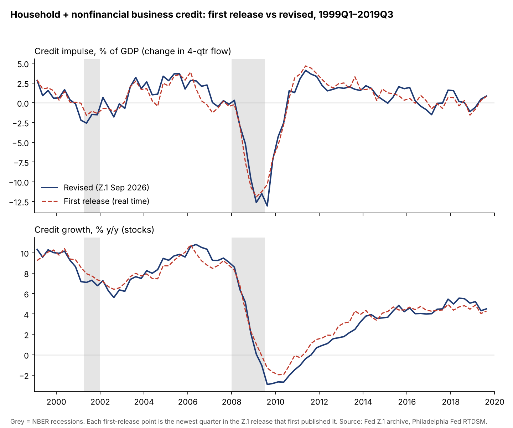
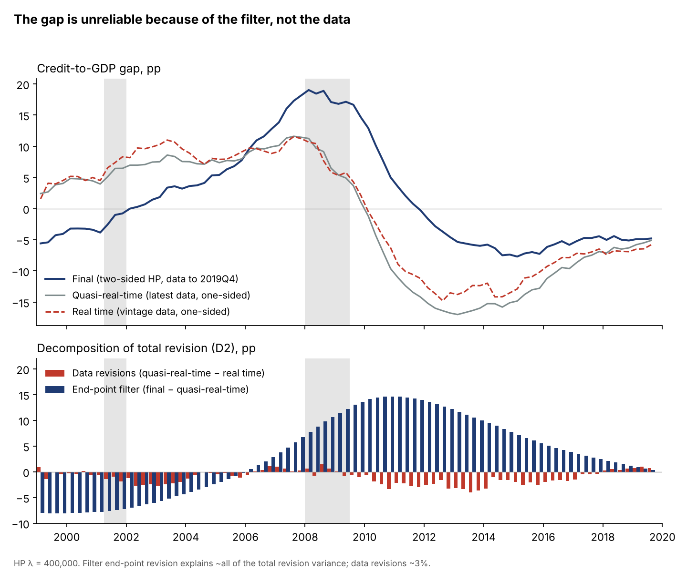
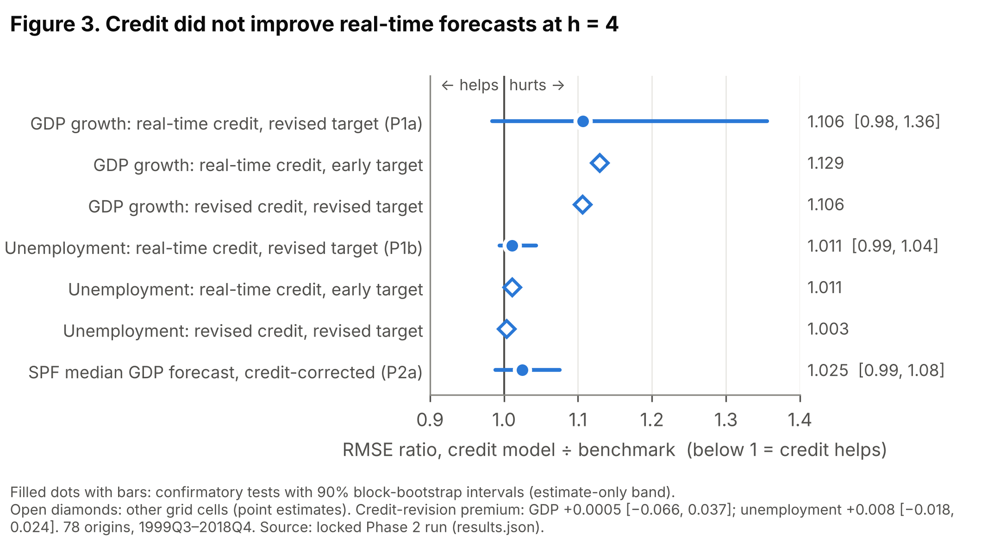
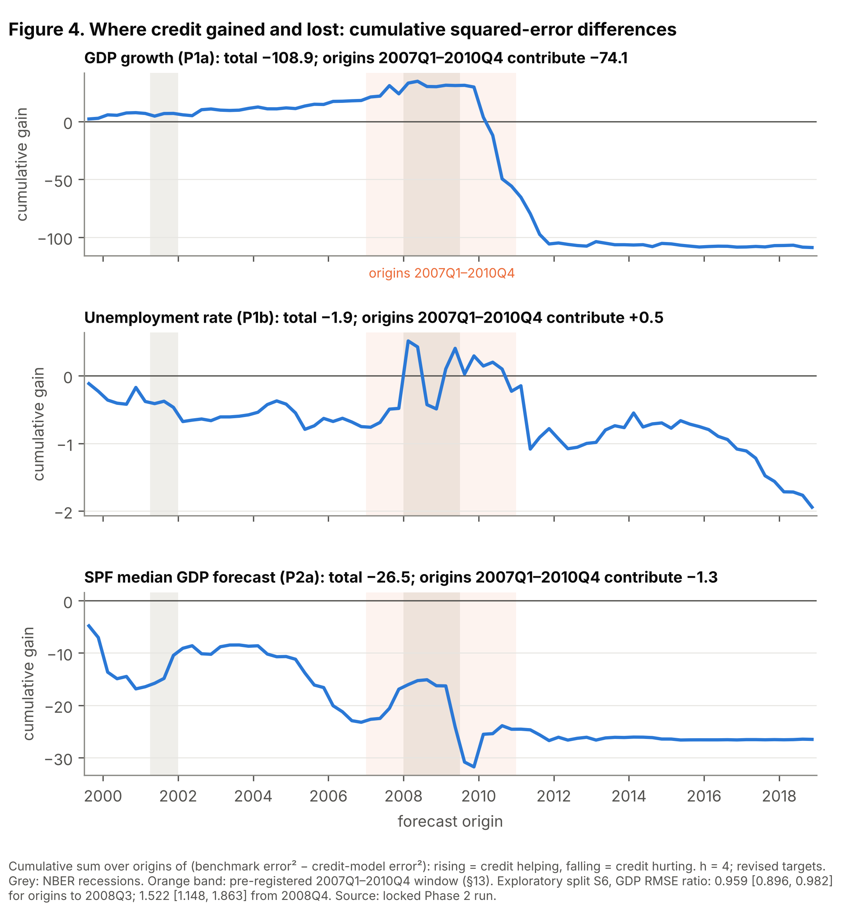
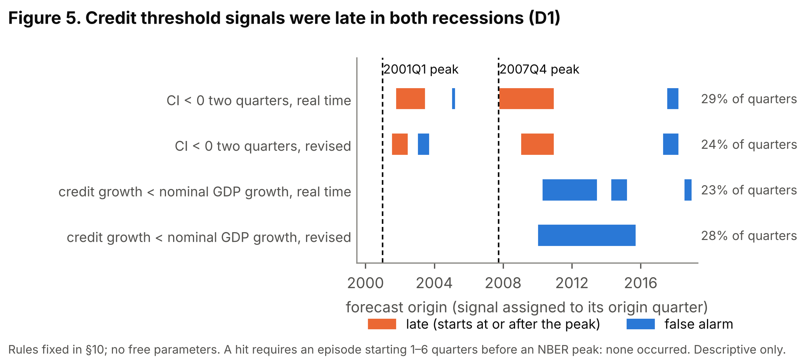
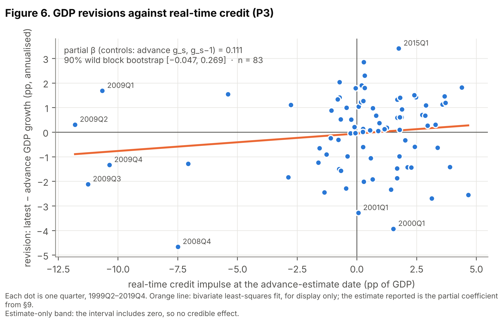

# Did Credit Help Forecasters in Real Time? A Preregistered Test, 1999–2019

Working paper draft · 19 October 2026 · Andy Moran (Heaviside Analytics)

## Abstract

We rebuild 83 dated releases of the Federal Reserve's Financial Accounts (Z.1), June 1999 to December 2019, into real-time vintages of household and nonfinancial business credit, and archive the result as a complete real-time record of US private credit as it was published. We use it for a preregistered evaluation over 78 forecast origins. The protocol, code and decision rules were locked in a public release before any outcome was scored (DOI [10.5281/zenodo.23477871](https://doi.org/10.5281/zenodo.23477871)).

The real-time credit impulse did not improve four-quarter-ahead forecasts of real GDP growth or unemployment, and later revisions to the credit data do not change that conclusion. Against a direct AR(2), adding the impulse raises the root-mean-square error of GDP forecasts by 10.6% (ratio 1.106; 90% interval 0.984–1.356). For unemployment the ratio is 1.011 (0.994–1.043). Used to correct the median Survey of Professional Forecasters GDP forecast, credit gives 1.025 (0.988–1.076). The impulse does not predict revisions to advance GDP (0.111 pp per point; 90% interval −0.047 to 0.269). The credit-revision premium is close to zero for both targets.

The average conceals a sharp asymmetry. For origins up to 2008Q3, credit improved GDP forecasts by about 4%, a modest gain spread over the expansion. From 2008Q4 it worsened them by about 50%, with the losses concentrated in forecasts of the 2011–12 recovery. Because about three-quarters of the impulse's variation comes from 2008–09, the design can detect only very large average gains. A standard Gaussian power simulation overstated power substantially; conditional on the realised predictor path, 80% power requires a gain of roughly 40%. We document that correction as a lesson for real-time evaluations of crisis-dominated predictors.

**Keywords:** real-time data, credit impulse, forecast evaluation, preregistration, Financial Accounts of the United States. **JEL:** C53, E17, E44, E51.

## 1. Introduction

Could a forecaster in real time have used published credit data to forecast US output and unemployment better? Over 1999–2019, the answer is no. This holds with credit measured as the data stood on the day, and with today's revised data.

The question matters because the post-2008 literature gives credit a central role in macro dynamics, and much of the forecasting evidence for that role uses revised data. Revised credit data were not available to anyone at the time. Data revisions, the timing of releases and the choice of transformation can each make a predictor look better after the fact than it was in use. Edge and Meisenzahl (2011) showed this for the credit-to-GDP gap: its real-time readings were revised by about as much as the gap itself. We ask the companion question about usefulness. Did credit, as published, carry information about later GDP, unemployment, professional forecast errors and GDP revisions?

We answer it with a preregistered design. We first rebuild the household and nonfinancial business credit series from 83 dated Z.1 releases (June 1999 to December 2019). Each forecast origin then sees only what had been published before it. The protocol, all analysis code, the power analysis and the wording of the headline conclusions were locked in a public release before any forecast was scored against an outcome (DOI [10.5281/zenodo.23477871](https://doi.org/10.5281/zenodo.23477871)). The confirmatory evidence consists of four pre-specified tests, and the paper reports them through a pre-committed interpretive map.

Three findings follow.

1. **No real-time forecasting value.** Adding the real-time credit impulse to a direct AR(2) raises the RMSE of four-quarter-ahead GDP forecasts by 10.6%. It leaves unemployment forecasts essentially unchanged (+1.1%). It does not improve the median SPF forecast (+2.5%), and it does not predict GDP revisions. None of the four 90% intervals clears no-gain. The credit-revision premium is close to zero, so the null does not arise from using unrevised data.
2. **An asymmetry around 2008.** For forecasts made up to 2008Q3, the credit model beat the benchmark for GDP by about 4% (90% interval 0.896–0.982), a gain spread across 1999–2008 rather than concentrated in the collapse. For forecasts made from 2008Q4 onwards, it was about 50% worse (1.148–1.863), almost entirely on forecasts made in 2010–11 for the 2011–12 recovery. Origins 2007Q1–2010Q4 account for 68% of the full-sample loss.
3. **Hints for unemployment, not for GDP, in exploratory models.** Slower-moving credit measures produce small unemployment-forecast gains of 2–8% in four exploratory specifications: the credit-to-GDP gap, real credit growth, a real-credit contraction model and a Markov-switching model. A BVAR including the impulse gives a similar 4.6% gain. Nothing comparable appears for GDP. They are uncorrected and drawn from about 30 comparisons, and we report them as leads, not findings.

The paper makes three contributions:

- **A real-time credit dataset.** It covers 83 Z.1 vintages from 1999 to 2019, with documented series-code and unit changes, and is publicly archived.
- **A clean preregistered null, with its power stated honestly.** The real credit impulse's variation is concentrated in a single episode, so the design can reliably detect only very large average gains. A standard Gaussian power simulation overstated power substantially, and we show how conditioning on the actual predictor path corrects it.
- **A disclosure trail of every deviation.** Each deviation is dated, including errors we caught in our own power analysis before lock. This lets readers judge the evidence rather than trust it.

Section 2 places the paper in the literature, Section 3 describes the data, Section 4 the design, Section 5 the results and Section 6 the interpretation. Appendix A lists all deviations and disclosures.

## 2. Related literature

This paper sits where three literatures meet: credit and the business cycle, real-time data, and forecast evaluation.

**Credit and the business cycle.** Long-run cross-country evidence links credit booms to later downturns (Schularick and Taylor, 2012; Jordà, Schularick and Taylor, 2013). Rises in household debt predict lower subsequent output growth (Mian, Sufi and Verner, 2017). The *credit impulse*, the change in new borrowing scaled by GDP, was proposed in late 2008 to explain why recoveries can occur without credit growth (Biggs, Mayer and Pick, 2009). Keen popularised a closely related "credit accelerator" within a Minskian account of financial instability (see Keen, 2013). Most of this evidence uses revised data and in-sample or pseudo-out-of-sample designs. Our question is narrower: whether the information was usable as published.

**Real-time data.** Real-time datasets let a researcher reproduce what a forecaster could have known (Croushore and Stark, 2001; Croushore, 2011). Real-time studies of model forecasts include Edge and Gürkaynak (2010) and Del Negro and Schorfheide (2013). The closest precedent is Edge and Meisenzahl (2011). Using real-time Z.1 vintages, they showed that revisions to the US credit-to-GDP gap were about as large as the gap itself, and came mainly from the filter's end-point problem rather than from data revisions. Their question is reliability. Ours is usefulness for macro forecasts and forecaster counterfactuals, and we replicate their decomposition on our vintages as a dataset check (Section 3).

**Credit signals out of sample.** Early-warning studies evaluate credit indicators in real time for *crisis* prediction (e.g. Alessi and Detken, 2011), not for output or unemployment forecasts. López-Buenache, Borsi and Rosa-García (2025) find that credit contractions improve the identification and recursive forecasting of US labour-market slack in a Markov-switching framework. We could not confirm whether their data are vintage-based. Our exploratory E1 applies a version of their signal to strictly real-time vintages over an overlapping 2000–2019 window.

**Methods.** Our tests follow Clark and West (2007) for nested forecast comparisons, with fixed-b inference (Kiefer and Vogelsang, 2005) and the Holm correction across the confirmatory family. The power analysis builds on simulation practice in forecast evaluation. We show that when a predictor's variation is concentrated in one episode, simulations that draw the predictor from a stationary Gaussian process overstate power. Conditioning on the realised predictor path corrects this (Section 4.4).

## 3. Data

The dataset rebuilds what a forecaster could have read in each quarterly Z.1 release from June 1999 to December 2019. Every vintage is dated to its publication day.

### 3.1 Real-time credit vintages

We downloaded all 83 quarterly Z.1 releases from 11 June 1999 to 12 December 2019, plus the release current at download (11 September 2026, data to 2026Q2), from the Federal Reserve's release archive. Every release date was verified against the archive. June 1999 is the first release with machine-readable full quarterly history. Earlier releases print only the last four to five years, which is why the confirmatory sample starts with the 1999Q3 origin.

Credit is households plus nonfinancial business: debt securities and loans, as flows (seasonally adjusted transactions at annual rates, divided by 4) and as levels. Three breaks, documented below, were handled by rule, not by smoothing:

- **Series code.** The household series code changed from 154102005 to 154104005 in the September 2010 release, when "credit market instruments" became "debt securities and loans". Series are matched by code, not position.
- **Units.** An undocumented units switch occurred in the March 2011 release: the debt files moved from $ billions to $ millions with no change of name. A parser check found a median level ratio of exactly 1000.000 between consecutive vintages.
- **File format.** CSV files replaced fixed-width files in September 2016, and the current release renames the debt tables.

As a consistency check, changes in levels track the flows closely (correlation 0.98 in the December 2019 vintage).

The primary measure is the credit impulse, the change in the four-quarter credit flow scaled by four-quarter nominal GDP:

```latex
CI_t = 100 \times \frac{S_t - S_{t-4}}{N_t}, \qquad S_t = \sum_{j=0}^{3} F_{t-j}, \qquad N_t = \sum_{j=0}^{3} Y^{nom}_{t-j}
```

Nominal GDP comes from the GDP vintage available at the same date. Secondary measures, each computed within every vintage, are:

- credit growth from levels;
- real credit growth, deflated with the real-time GDP deflator;
- the credit-to-GDP gap: a one-sided HP filter with λ = 400,000 and at least 40 quarters of history.

### 3.2 Macro vintages and forecasts

GDP, the deflator and unemployment vintages come from the Philadelphia Fed Real-Time Data Set for Macroeconomists. Each vintage is dated to the 15th of the middle month of its quarter.

- **Revised targets** are taken from the 2026Q3 vintage, frozen and hashed.
- **Early-estimate targets** come from the vintage two quarters after the target quarter.
- **SPF forecasts** are the median forecasts four quarters ahead: drgdp6 for GDP growth and UNEMP6 for the unemployment rate. Survey deadlines come from the Philadelphia Fed's release-dates file.
- **The two-year Treasury yield** (FRED GS2), which is not revised, enters only the exploratory BVAR.

At every one of the 78 forecast origins, the latest Z.1 release ended two quarters before the origin (k = 2).

### 3.3 How much are credit data revised?

Credit flows are revised modestly; the credit-to-GDP gap is revised heavily, almost entirely because of its filter. Table 1 compares each quarter's first-release value with today's, over 83 quarters (1999Q1–2019Q3).

**Table 1. First-release versus revised credit measures, 1999Q1–2019Q3**

| Measure | Mean revision (pp) | SD of revision | Noise / signal | Correlation | Sign agreement |
| --- | --- | --- | --- | --- | --- |
| Credit impulse | +0.03 | 0.95 | 0.28 | 0.96 | 86% |
| Credit growth | −0.19 | 0.69 | 0.18 | 0.99 | 98% |
| Real credit growth | −0.30 | 0.70 | 0.21 | 0.98 | 95% |
| Credit-to-GDP gap, data revisions only | −1.13 | 1.32 | 0.14 | 0.99 | 100% |

*Noise / signal = SD of revision ÷ SD of the revised series. Revisions to GDP barely matter: credit-only revisions to the impulse (noise / signal 0.28) are as large as total revisions.*

The largest impulse revisions fall at turning points. The first estimate for 2008Q3 was −7.5, against −5.2 today. For 2006Q4 the first estimate showed credit slowing (−0.27), where today's data show it still accelerating (+2.25).



*Figure 1. Credit impulse and credit growth: first release versus revised, 1999Q1–2019Q3*

Replicating Edge and Meisenzahl (2011) on our vintages, we split each quarter's gap revision into a data component (the gap recomputed on today's data, filtered only up to that quarter) and an end-point filter component. The data component accounts for 3% of the revision variance and the filter for 108%, with a covariance of −11%. Mean absolute revisions are 1.4 pp (data) against 7.0 pp (filter). The real-time and final gaps correlate at 0.65 and share a sign in 76% of quarters. The gap's real-time readings are also distorted by its denominator: it rose during the 2001 recession because GDP slowed while credit kept growing. These results validate the dataset and motivate making the unfiltered impulse the primary measure.



*Figure 2. Credit-to-GDP gap: real time, quasi-real time and final, with the D2 decomposition*

## 4. Design

Every forecast uses only data published before its origin date, and every specification below was fixed in the locked protocol (v2.3, §§5–11) before any outcome was scored.

### 4.1 Grid, origins and targets

The design crosses two credit vintages (real-time, revised) with two targets (early estimate, revised). The primary cell is real-time credit scored against the revised target. The *credit-revision premium* is the primary-cell RMSE ratio minus the same ratio computed with revised credit and the real-time GDP denominator; a positive premium means revised credit forecasts better.

There are 78 origins, 1999Q3–2018Q4. The horizon is h = 4, matching the SPF; h = 1 and h = 2 are secondary. Any forecast whose target falls in 2020Q1 or later is excluded. The origin date is the 15th of the middle month of quarter o. GDP and unemployment are observed through o − 1 in that vintage. Credit comes from the latest Z.1 release dated before the origin, ending at q\* = o − 2. GDP growth is annualised and discretely compounded, as in BEA and SPF practice. Unemployment is the quarterly average level.

### 4.2 Models

The benchmark is a direct AR(2). The credit model adds four published lags of the credit measure, entering at their release lags with nothing filled in:

```latex
y_{o+h} = \alpha + \phi_1 y_{o-1} + \phi_2 y_{o-2} + \sum_{j=0}^{3} \beta_j X_{q^*-j} + \varepsilon_{o+h}
```

Both models are re-estimated at every origin on an expanding window from 1965Q1, using only pairs whose target had been published by the origin. A direct specification needs no forecast of credit, and it nests the AR(2) exactly.

The linear specification is a deliberate restriction, not a claim that credit acts linearly. It asks one falsifiable question: did the credit impulse carry a stable average incremental relationship with the target over the sample? It is also the specification the preregistration committed to before any outcome was scored.

Two costs follow. First, a linear model pools states. If credit helps in some phases of the cycle and hurts in others, the pooled coefficient averages opposite-signed effects and can understate state-specific ones. Section 5.3 documents exactly this: a modest gain over the expansion and a large loss in the recovery. Second, the four published lags assume a relationship that is stable within the estimation window and symmetric in sign.

The exploratory specifications relax both assumptions. S5 allows asymmetric and contraction-specific effects, S4 and E1 allow richer dynamics and regimes, and the subsample split (S6) and rolling window allow instability. We keep the confirmatory family linear because allowing state dependence in advance would have multiplied the parameters to be estimated against 78 origins dominated by a single episode. Section 4.4 shows the design can already detect only very large average gains. The null in Section 5.1 is therefore a statement about the average linear relationship, not about any particular regime.

For the SPF counterfactual (P2a), the bias-corrected benchmark is the SPF forecast plus α̂. The credit-corrected forecast adds β̂ times the impulse published before the survey deadline. Both corrections keep the coefficient on the SPF forecast fixed at 1. They are estimated on surveys from 1990Q3 onwards whose targets had been published, with values as published at the deadline; there are 32 training pairs at the first origin.

The revision test (P3) regresses the revision from the advance estimate to today's estimate of GDP growth in quarter s on the impulse published before the advance release. It controls for advance growth in s and s − 1, with one observation per quarter for 83 quarters, 1999Q2–2019Q4.

### 4.3 Inference and decision rules

The confirmatory family is P1a (GDP), P1b (unemployment), P2a (SPF) and P3, under the Holm correction.

- **Forecast comparisons** use Clark–West statistics with Bartlett HAC variance (h − 1 lags) and fixed-b critical values. Fixed-b values were adopted because normal critical values over-rejected at these sample sizes.
- **P3** uses a restricted wild (Rademacher) block bootstrap of its HAC t-statistic (block 4), because a few extreme impulse values made fixed-b HAC over-reject (14–18% at a nominal 5%; the bootstrap gives 3.5%).
- **Intervals** for RMSE ratios come from a moving-block bootstrap (block 4, 2,000 draws).

All interpretation runs through a pre-committed map. Three headline sentences were written before lock, for "positive", "null with a large premium" and "null with a small premium". A premium is *large* if it is at least 0.05 in ratio units and its 90% interval excludes zero.

### 4.4 Power, and why a Gaussian simulation overstated it

The real credit impulse is quiet for most of 1999–2019 and swings violently in 2008–09: those 8 of 83 quarters hold 72% of its squared deviations from the mean. Any forecasting gain from credit must therefore come from a handful of quarters, which makes Clark–West loss differentials highly skewed. Our first power simulations drew the impulse from a fitted Gaussian AR(2) and missed this.

We re-ran power conditional on the realised credit path, simulating targets, vintages and SPF forecasts around the real impulse. No outcome data were used. Table 2 shows the comparison.

**Table 2. Unadjusted power at a true RMSE ratio of about 0.90**

| Test | Gaussian-path simulation | Actual credit path |
| --- | --- | --- |
| P1a GDP | 0.86 | 0.45 |
| P1b unemployment | 0.70 | 0.31 |
| P2a SPF | 0.77 | 0.51 |

*Actual-path cells are at true ratios of 0.91 (P1a) and 0.93 (P1b, P2a), the nearest simulated grid points. The Gaussian P2a cell is at P2a's own true ratio of 0.92.*

On the actual path, 80% power requires a ratio of about 0.6, a gain of roughly 40%. Under the pre-registered power rule, every confirmatory test therefore falls in the "estimate only" band. Each is reported as an estimate with a 90% interval. "Credible improvement" is claimed only if the whole interval lies below 1 (for P3, excludes zero), and no significance language is used.

On synthetic data with the real credit path, this rule declares a false improvement 0–2% of the time. It detects a true 7% gain 29–40% of the time. These decisions were taken before any outcome was seen (Appendix A). The lesson generalises: when a predictor's information sits in one episode, power should be simulated conditional on its realised path.

## 5. Results

None of the four confirmatory estimates shows a credible improvement. Credit worsened real-time GDP forecasts by 10.6% on average, and the credit-revision premium is close to zero. All results come from a single run of the locked code (results.json, SHA-256 9e4239dd…).

### 5.1 Confirmatory tests

**Table 3. Confirmatory results, h = 4, 1999Q3–2018Q4 origins**

| Test | Estimate | 90% interval | Credible improvement | Holm-adjusted rejection |
| --- | --- | --- | --- | --- |
| P1a: GDP growth, RMSE ratio | 1.106 | 0.984 – 1.356 | No | No |
| P1b: unemployment rate, RMSE ratio | 1.011 | 0.994 – 1.043 | No | No |
| P2a: SPF median GDP, RMSE ratio | 1.025 | 0.988 – 1.076 | No | No |
| P3: GDP revision on impulse, pp per point | 0.111 | −0.047 – 0.269 | No | No |

*Ratios are credit model ÷ benchmark; below 1 means credit helps. Unadjusted p-values, reported for completeness only: 0.555, 0.618, 0.665, 0.221. For P3 the fixed-b HAC p-value would be 0.036; the pre-registered wild bootstrap governs (Section 4.3).*

The intervals are informative as well as null. At their most favourable end, they allow a gain of at most about 2% for GDP, 1% for the SPF and 0.6% for unemployment.



*Figure 3. RMSE ratios with 90% intervals for the confirmatory tests and grid cells*

### 5.2 The grid and the credit-revision premium

Using revised rather than real-time credit leaves the GDP ratio unchanged at 1.106; for unemployment it moves from 1.011 to 1.003. The credit-revision premium is +0.0005 for GDP (90% interval −0.066 to 0.037) and +0.008 for unemployment (−0.018 to 0.024). Both are *small* under the pre-registered rule. Against early-estimate targets the ratios are 1.129 (GDP) and 1.011 (unemployment).

### 5.3 Where credit gained and lost

The full-sample loss for GDP is concentrated in one turn of the cycle. Figure 4 accumulates, origin by origin, the benchmark's squared error minus the credit model's.

- **GDP.** The credit model edges ahead from 2000, peaks at the 2008Q2 origin and holds that lead through forecasts made in 2009. It then loses heavily on forecasts made in 2010–11 for 2011–12 (−135.6 over origins 2010Q1–2011Q4). Of a total cumulative loss of 108.9, origins 2007Q1–2010Q4 contribute 74.1 (68%).
- **The pre-2008Q4 split (exploratory S6).** Splitting origins at 2008Q4 gives ratios of 0.959 (0.896–0.982) before and 1.522 (1.148–1.863) after. The pre-2008Q4 gain is spread out: origins 1999–2006 contribute 18.2 of the 30.2 total and 2007Q1–2008Q3 add 12.1. The real-time impulse was deeply negative in data through 2010Q3, and the model, its coefficients shaped by the collapse, kept forecasting weakness into the 2011–12 recovery.
- **Unemployment and the SPF.** Neither shows a sustained gain; unemployment's 2007–10 contribution is a small +0.5. The SPF correction loses from the start (total −26.5, of which −1.3 comes from 2007–10).



*Figure 4. Cumulative squared-error differences for P1a, P1b and P2a*

### 5.4 Exploratory results

These are uncorrected and drawn from about 30 comparisons, so one or two nominally significant results are expected by chance. None moves the interpretation (Section 6).

**Table 4. Selected exploratory RMSE ratios, h = 4**

| Specification | GDP growth | Unemployment |
| --- | --- | --- |
| S2: credit growth (levels) | 1.089 | 1.041 |
| S2: credit-to-GDP gap | 1.102 | 0.922 |
| S2: real credit growth | 1.030 | 0.978 |
| S2: impulse from level differences | 1.107 | 1.014 |
| S5: asymmetric impulse (CI⁺, CI⁻) | 1.053 | 1.249 |
| S5: real-credit contraction model | 1.055 | 0.957 |
| S4: BVAR with credit vs without | 0.989 | 0.954 |
| E1: Markov-switching contraction signal | — | 0.968 |
| R1: ragged edge filled by AR(4) / VAR(2) | 1.054 / 1.056 | 1.001 / 1.000 |
| 60-quarter rolling window | 1.243 | 1.097 |
| h = 1 / h = 2 | 1.030 / 1.030 | 1.034 / 1.017 |

*Unadjusted one-sided p-values below 0.05 occur only for unemployment: the gap (0.002), real credit growth (0.025), the contraction model (0.002) and E1 (0.026). The BVAR's bootstrap p is 0.078.*

Slower-moving credit measures show small unemployment gains of 2–8%, and the BVAR with the impulse gains 4.6%. For GDP only the BVAR falls below 1, at 0.989. The SPF unemployment counterfactual (P2b) gives 1.115, and the robustness version of P2a, using medians of forecasters' own growth rates, gives 1.026. Adding credit lowers the share of correct direction calls for unemployment from 66.2% to 64.9%.

### 5.5 Threshold signals (D1)

Neither pre-registered rule produced a timely warning. "Impulse negative for two quarters" started at or after the 2001 and 2007 peaks in both real-time and revised data, so both count as late. It also gave two false alarms in each version and was on in 29% of real-time quarters. "Credit growth below nominal GDP growth" produced only false alarms, all starting in 2010 or later.



*Figure 5. Credit threshold signals, real-time and revised (D1)*

Figure 6 plots the P3 data: the 2009 quarters, with impulses of −10 to −12, show revisions in both directions.



*Figure 6. GDP revisions against real-time credit (P3)*

## 6. Interpretation and limits

Under the pre-committed map, the headline is **"null, small premium"**:

> *Credit shows no detectable predictive content in either real-time or revised data at this sample size; the published evidence does not rest on revisions, and given that the available credit variation is concentrated in 2008–09, the design could reliably detect only very large gains, of roughly 40% or more.*

The detailed map distinguishes a "specification story" (the signal lives in contractions, S5 supported) from a plain null (S5 null). S5 was mixed: the contraction model improved unemployment forecasts (0.957), while the asymmetric impulse worsened them (1.249), and both worsened GDP forecasts. The protocol did not define "supported" for S5, so we record S5 as not supported. That is the conservative reading. It was made after the results were seen, and Appendix A discloses it. The final reading is therefore: *no evidence of predictive content under real-time data at this sample size; only very large gains ruled out.*

Five qualifications shape what this means.

1. **The null is about the average, not every episode.** Credit helped GDP forecasts modestly before 2008Q4, over many years, and then hurt forecasts of the recovery. A forecaster who used the impulse only to judge downside risk might have done better than our linear model suggests. The pre-registered evidence cannot say whether such a rule would hold beyond one episode.
2. **The recessions in this sample differed in character.** The 2001 downturn is not usually regarded as credit-driven; 2008–09 is. In real time, the impulse threshold signalled both downturns late, and the credit-growth threshold produced only false alarms, all starting in 2010 or later (Section 5.5). Such differences caution against a single, state-independent coefficient linking credit to output. This design cannot classify recession types or estimate episode-specific effects; that needs an explicit regime-switching or interaction specification, which we leave to future work.
3. **The sample contains one large credit cycle, which is also why power is low.** 2008–09 holds about three-quarters of the impulse's variation. Settling the question needs a longer real-time history: either the hybrid 1990–1999 vintages the protocol leaves exploratory, or other countries' real-time credit data.
4. **The exploratory unemployment signals are leads, not findings.** The gap, real credit growth, the real-credit contraction model and the Markov-switching model all point the same way for unemployment, by 2–8%, as does the BVAR (4.6%). The first four rest on slower-moving stock measures, the impulse itself did not help unemployment (1.011), and the multiplicity is high. A new preregistered test on a different sample would be needed.
5. **The design is linear and the credit measures are narrow.** The confirmatory family estimates one average relationship on four published lags of the impulse. All four measures are transformations of one aggregate, household plus nonfinancial business credit. Neither choice can speak to state-dependent effects, to the sectoral composition of debt, or to debt-service burdens and credit-supply indicators such as lending standards, which several literatures treat as central. This limits what the null covers; it is not a claim that those channels are absent. A richer test would need a longer real-time history or cross-country vintages, because a state-dependent, multi-variable specification cannot be identified on 78 origins dominated by one crisis.

What the results do not say: they make no causal claim about credit and demand, and no claim about forecasters' rationality. The SPF counterfactual asks only whether the information was in published data. Nor do they say anything about the DSGE or policy debates that motivated the project. Before 2008 the credit impulse had not been defined, so pre-2008 results show what the transformation would have delivered, not what forecasters knew.

### 6.1 Discussion beyond the pre-registered map

*This subsection relates the results to one theoretical literature. It is not part of the pre-registered interpretive map and carries no evidential weight beyond the estimates above.*

The results speak only indirectly to Keen's broader argument that credit creation drives aggregate demand and financial instability (Keen, 2013). The paper does not test, and cannot rule out, the proposition that credit dynamics matter causally for demand or for crises. It tests a narrower forecasting implication: that the real-time credit impulse, the closest observable counterpart of the credit accelerator, delivers systematic average gains in four-quarter-ahead GDP and unemployment forecasts whatever the state of the cycle. Over 1999–2019 it did not. The 90% intervals are inconsistent with average gains larger than about 2% for GDP, 1% for the SPF correction and 0.6% for unemployment.

Two readings are compatible with this.

- **Episode-specific value.** Credit dynamics matter but differ across cycles, so their forecasting value is episode-specific and does not survive as a stable linear signal. The asymmetry in Section 5.3 fits this reading, though one episode cannot establish it.
- **Little extra information.** The impulse adds little that recent output data do not already carry.

The design cannot separate the two. Nor do the exploratory unemployment results favour the credit-accelerator view specifically. The small gains came from slower-moving stock measures, while the impulse itself, the measure closest to that view, did not improve unemployment forecasts.

## 7. Conclusion

As published at the time, the US credit impulse would not have improved average four-quarter-ahead forecasts of GDP or unemployment over 1999–2019, and revised credit data would not have either. Its record in this period is dominated by a single episode: a modest pre-crisis gain was more than wiped out by misreading the 2011–12 recovery.

Two practical lessons follow.

- **Turning points.** Credit information may be worth more as a guide to turning points than as a linear predictor, though one episode cannot establish that.
- **Power.** Real-time evaluations of crisis-dominated predictors should estimate power conditional on the realised predictor path. Gaussian simulations can make an underpowered design look adequate.

The design points to five extensions, in rough order of value per unit of cost. Each tests a new hypothesis and would need its own preregistration.

1. **Household versus business credit.** The aggregate can be split within the existing vintages, testing whether the null masks the household-debt signal emphasised by Mian, Sufi and Verner (2017).
2. **Downside risk.** The asymmetry in Section 5.3 and the downside-risk reading in Section 6 can be tested directly with quantile or growth-at-risk forecasts (Adrian, Boyarchenko and Giannone, 2019). A null for the mean is compatible with a gain in the lower tail, and this is the most promising unexplored hypothesis here.
3. **Power for crisis-dominated predictors.** The correction in Section 4.4 is not specific to credit and merits separate treatment.
4. **Credit supply.** Lending standards and debt-service burdens measure a different channel from the credit quantity studied here, and are observable in real time.
5. **A cross-country real-time panel.** The most expensive option, it multiplies episodes rather than origins, and is the only route that would give a state-dependent specification real power.

Two other extensions would add computation but not evidence. Regularised or nonparametric learners applied to 78 origins dominated by one episode would fit the crisis rather than the relationship. Further linear variants of the confirmatory family would add to the multiplicity of Table 4 rather than test a new hypothesis. Neither is a criticism of those methods; both need the longer or wider samples above.

The real-time credit vintages, all code and the locked protocol are public.

## Appendix A. Deviations and disclosures

Every change after the design was drafted is logged with its date and whether results had been seen. The full log (Entries 1–25) is part of the protocol record; the table lists the changes that bear on the reported tests.

| Date (2026) | What | Results seen? |
| --- | --- | --- |
| 17 Oct | Real-time GDI vintages were too short (gate G3 failed), so exploratory test S3 was dropped, as the protocol pre-specified. | No |
| 19 Oct | First power simulations used one credit lag, a 1955 start, a looser SPF correction and no P3 controls. Corrected to the protocol's specification; wording bands re-derived. | No |
| 19 Oct | Normal critical values over-rejected; switched to fixed-b. | No |
| 19 Oct | Power re-estimated conditional on the actual credit path. All four confirmatory tests moved to "estimate only"; P3 moved to a wild block bootstrap; a 2007–10 crisis-share statistic added. | No |
| 19 Oct | The premium's sign convention was corrected so that positive means revised credit forecasts better; the E1 specification was written out in full. | No |
| 19 Oct | D1 threshold signals were computed during synthetic testing, because they use only credit data and recession dates; seen before lock. | D1 only |
| 19 Oct | Protocol locked: GitHub release v1.0-lock, commit 4eb084f, DOI 10.5281/zenodo.23477871. | No |
| 19 Oct | Phase 2 run once with the locked code; no deviations. | — |
| 19 Oct | S5 recorded as not supported, the conservative reading; the protocol did not define S5 support. | Yes |

**Use of AI.** The analysis code, power simulations and drafting were carried out with Claude (Anthropic) under the author's direction. All design decisions and interpretive choices were the author's, and each is recorded in the log.

## Data and code availability

- **Preregistration:** GitHub release [v1.0-lock](https://github.com/AndyMoran/credit-impulse-realtime-prereg/releases/tag/v1.0-lock), commit 4eb084f, archived at DOI [10.5281/zenodo.23477871](https://doi.org/10.5281/zenodo.23477871).
- **Results, figures and this paper** are in release [v2.0-results](https://github.com/AndyMoran/credit-impulse-realtime-prereg/releases/tag/v2.0-results) (commit 27fab0b), archived at DOI [10.5281/zenodo.23479717](https://doi.org/10.5281/zenodo.23479717), with a dated log of every post-lock step (DEVIATIONS.md).
- **Raw inputs** are public: the Federal Reserve Z.1 archive, the Philadelphia Fed Real-Time Data Set and SPF, and FRED GS2. The exact versions are identified by the SHA-256 hashes in MANIFEST.txt.

## References

*Bibliographic details checked against publisher or RePEc records, 19 October 2026.*

- Adrian, T., Boyarchenko, N. and Giannone, D. (2019). Vulnerable growth. *American Economic Review* 109(4): 1263–1289. [doi:10.1257/aer.20161923](https://www.aeaweb.org/doi/10.1257/aer.20161923)
- Alessi, L. and Detken, C. (2011). Quasi real time early warning indicators for costly asset price boom/bust cycles: a role for global liquidity. *European Journal of Political Economy* 27(3): 520–533.
- Biggs, M., Mayer, T. and Pick, A. (2009). Credit and economic recovery. De Nederlandsche Bank Working Paper No. 218. Revised as "Credit and economic recovery: demystifying phoenix miracles" (2010); summary in [VoxEU, 14 May 2010](https://cepr.org/voxeu/columns/myth-phoenix-miracle).
- Clark, T. E. and West, K. D. (2007). Approximately normal tests for equal predictive accuracy in nested models. *Journal of Econometrics* 138(1): 291–311.
- Croushore, D. (2011). Frontiers of real-time data analysis. *Journal of Economic Literature* 49(1): 72–100. doi:10.1257/jel.49.1.72
- Croushore, D. and Stark, T. (2001). A real-time data set for macroeconomists. *Journal of Econometrics* 105(1): 111–130.
- Del Negro, M. and Schorfheide, F. (2013). DSGE model-based forecasting. In G. Elliott and A. Timmermann (eds), *Handbook of Economic Forecasting*, Vol. 2A, 57–140. Amsterdam: Elsevier/North-Holland.
- Edge, R. M. and Gürkaynak, R. S. (2010). How useful are estimated DSGE model forecasts for central bankers? *Brookings Papers on Economic Activity* 41(2): 209–244. doi:10.1353/eca.2010.0015
- Edge, R. M. and Meisenzahl, R. R. (2011). The unreliability of credit-to-GDP ratio gaps in real time: implications for countercyclical capital buffers. *International Journal of Central Banking* 7(4), December; [FEDS 2011-37](https://www.federalreserve.gov/econres/feds/the-unreliability-of-credit-to-gdp-ratio-gaps-in-real-time-implications-for-countercyclical-capital-buffers.htm).
- Federal Reserve Bank of Philadelphia. [Real-Time Data Set for Macroeconomists](https://philadelphiafed.org/research-and-data/real-time-center/real-time-data); [Survey of Professional Forecasters documentation](https://www.philadelphiafed.org/-/media/frbp/assets/surveys-and-data/survey-of-professional-forecasters/spf-documentation.pdf).
- Jordà, Ò., Schularick, M. and Taylor, A. M. (2013). When credit bites back. *Journal of Money, Credit and Banking* 45(s2): 3–28.
- Keen, S. (2013). A monetary Minsky model of the Great Moderation and the Great Recession. *Journal of Economic Behavior & Organization* 86: 221–235.
- Kiefer, N. M. and Vogelsang, T. J. (2005). A new asymptotic theory for heteroskedasticity-autocorrelation robust tests. *Econometric Theory* 21(6): 1130–1164.
- López-Buenache, G., Borsi, M. T. and Rosa-García, A. (2025). Credit cycles as predictors of labor market slack: evidence from the U.S. *Economic Analysis and Policy* 88. [doi:10.1016/j.eap.2025.08.006](https://doi.org/10.1016/j.eap.2025.08.006)
- Mian, A., Sufi, A. and Verner, E. (2017). Household debt and business cycles worldwide. *Quarterly Journal of Economics* 132(4): 1755–1817.
- Repullo, R. and Saurina, J. (2011). The countercyclical capital buffer of Basel III: a critical assessment. CEPR Discussion Paper No. 8304.
- Schularick, M. and Taylor, A. M. (2012). Credit booms gone bust: monetary policy, leverage cycles, and financial crises, 1870–2008. *American Economic Review* 102(2): 1029–1061.
