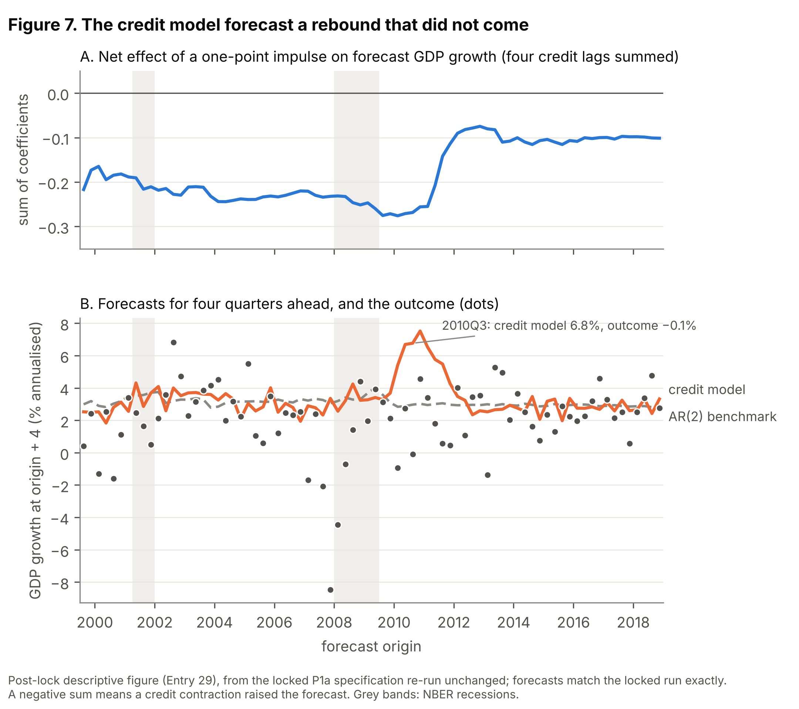

# Did the Credit Impulse Help Forecasters in Real Time? A Preregistered Test, 1999–2019

Working paper draft, version 2.1 · 20 October 2026 · Andy Moran (Heaviside Analytics)

## Abstract

We rebuild 83 dated releases of the Federal Reserve's Financial Accounts (Z.1), June 1999 to December 2019, into real-time vintages of household and nonfinancial business credit, and archive the result as a complete, machine-readable real-time record of US household and nonfinancial business credit for 1999–2019. We use it for a preregistered evaluation over 78 forecast origins. The protocol, code and decision rules were locked in a public release before any outcome was scored (DOI [10.5281/zenodo.23477871](https://doi.org/10.5281/zenodo.23477871)).

The real-time credit impulse did not improve four-quarter-ahead forecasts of real GDP growth or unemployment, and later revisions to the credit data do not change that conclusion. Against a direct AR(2), adding the impulse raises the root-mean-square error of GDP forecasts by 10.6% (ratio 1.106; 90% interval 0.984–1.356). For unemployment the ratio is 1.011 (0.994–1.043). Correcting the median Survey of Professional Forecasters GDP forecast with credit gives an RMSE ratio of 1.025 (0.988–1.076). The impulse does not predict revisions to advance GDP (0.111 pp per point; 90% interval −0.047 to 0.269). The credit-revision premium is close to zero for both targets. The comparison is with a direct autoregressive benchmark and one additive credit correction to the SPF median, not with the best available forecasting models.

Nor was there a stable signal underneath the average. Forecasts made from 2008Q4 onwards lost about 50% against the benchmark, when the model, reading the deep 2009–10 credit contraction, forecast a strong rebound in 2011–12 that did not come. Because about three-quarters of the impulse's variation comes from 2008–09, the design can reliably detect only very large average gains: conditional on the realised predictor path, 80% power requires a gain of roughly 40%, and a standard Gaussian power simulation overstated power substantially. That does not rule out smaller gains. On the realised path, nominal 90% block-bootstrap intervals cover the truth only 69–81% of the time. In a sensitivity analysis that widens them to restore 90% coverage, the estimates still show no convincing average gain, but gains of up to about 6% cannot be excluded. A crisis-concentrated predictor distorts power simulations and bootstrap intervals in the same way, and real-time evaluations of such predictors should check both on the realised path.

**Keywords:** real-time data, credit impulse, forecast evaluation, preregistration, Financial Accounts of the United States. **JEL:** C53, E17, E44, E51.

## 1. Introduction

Could a forecaster in real time have used published credit data to forecast US output and unemployment better? Over 1999–2019 we find no convincing average gain over a simple autoregressive benchmark, and no stable linear relationship that a forecaster could have exploited, though the data cannot rule out modest gains. This holds with credit measured as the data stood on the day, and with today's revised data.

The question matters because the post-2008 literature gives credit a central role in macro dynamics, and much of the forecasting evidence for that role uses revised data. Revised credit data were not available to anyone at the time. Data revisions, the timing of releases and the choice of transformation can each make a predictor look better after the fact than it was in use. Edge and Meisenzahl (2011) showed this for the credit-to-GDP gap: its real-time readings were revised by about as much as the gap itself. We ask the companion question about usefulness. Did credit, as published, carry information about later GDP, unemployment, professional forecast errors and GDP revisions?

We answer it with a preregistered design. We first rebuild the household and nonfinancial business credit series from 83 dated Z.1 releases (June 1999 to December 2019). Each forecast origin then sees only what had been published before it. The protocol, all analysis code, the power analysis and the wording of the headline conclusions were locked in a public release before any forecast was scored against an outcome (DOI [10.5281/zenodo.23477871](https://doi.org/10.5281/zenodo.23477871)). The confirmatory evidence consists of four pre-specified tests, and the paper reports them through a pre-committed interpretive map.

Three findings follow.

1. **No convincing average gain.** Adding the real-time credit impulse to a direct AR(2) raises the RMSE of four-quarter-ahead GDP forecasts by 10.6%. It leaves unemployment forecasts essentially unchanged (+1.1%). It does not improve the median SPF forecast (+2.5%), and it does not predict GDP revisions. None of the four 90% intervals clears no-gain, though intervals widened for their undercoverage still allow modest gains (Section 5.1). The credit-revision premium is close to zero, so the null does not arise from using unrevised data.
2. **An unstable relationship around 2008.** Forecasts made from 2008Q4 onwards were about 50% worse than the benchmark, almost entirely because the model, reading the deeply negative impulse of 2009–10, forecast a rebound in 2011–12 that did not come. Before 2008Q4 the exploratory split S6 shows a small gain of about 4%, but it is fragile: the pre-crisis credit path has too little variation for the design to identify an effect either way, and intervals like its nominal one arise about 5% of the time with no credit effect at all (Section 5.3). Origins 2007Q1–2010Q4 account for 68% of the full-sample loss.
3. **Hints for unemployment, not for GDP, in exploratory models.** Slower-moving credit measures produce small unemployment-forecast gains of 2–8% in four exploratory specifications: the credit-to-GDP gap, real credit growth, a real-credit contraction model and a Markov-switching model. A BVAR including the impulse gives a similar 4.6% gain. Nothing comparable appears for GDP. They are uncorrected and drawn from about 30 comparisons, and we report them as leads, not findings.

The paper makes three contributions:

- **A real-time dataset of household and nonfinancial business credit.** It covers 83 Z.1 vintages from 1999 to 2019, with documented series-code and unit changes, and is publicly archived.
- **A preregistered evaluation with a null result, and a design caution.** The real credit impulse's variation is concentrated in a single episode, so the design can reliably detect only very large average gains. A standard Gaussian power simulation overstated power substantially, and the block-bootstrap intervals cover less than their nominal level. Conditioning on the actual predictor path reveals both.
- **A disclosure trail of every deviation.** Each deviation is dated, including errors we caught in our own power analysis before lock. This lets readers judge the evidence rather than trust it.

Section 2 places the paper in the literature, Section 3 describes the data, Section 4 the design, Section 5 the results and Section 6 the interpretation. Appendix A lists all deviations and disclosures.

## 2. Related literature

This paper sits where three literatures meet: credit and the business cycle, real-time data, and forecast evaluation.

**Credit and the business cycle.** Long-run cross-country evidence links credit booms to later downturns (Schularick and Taylor, 2012; Jordà, Schularick and Taylor, 2013). Rises in household debt predict lower subsequent output growth (Mian, Sufi and Verner, 2017). The *credit impulse*, the change in new borrowing scaled by GDP, was proposed in late 2008 to explain why recoveries can occur without credit growth (Biggs, Mayer and Pick, 2009). Keen popularised a closely related "credit accelerator" within a Minskian account of financial instability (see Keen, 2013). Elevated credit-market sentiment predicts weaker subsequent growth (López-Salido, Stein and Zakrajšek, 2017), and credit-gap indicators underpin countercyclical policy rules (Aikman, Haldane and Nelson, 2015). Most of this evidence uses revised data and in-sample or pseudo-out-of-sample designs. Credit spreads, a price rather than a quantity, carry substantial predictive content for the business cycle (Gilchrist and Zakrajšek, 2012); they measure a different channel from the credit flows studied here. Our question is narrower: whether the information in credit quantities was usable as published.

**Real-time data.** Real-time datasets let a researcher reproduce what a forecaster could have known (Croushore and Stark, 2001; Croushore, 2011). Real-time studies of model forecasts include Edge and Gürkaynak (2010) and Del Negro and Schorfheide (2013). The closest precedent is Edge and Meisenzahl (2011). Using real-time Z.1 vintages, they showed that revisions to the US credit-to-GDP gap were about as large as the gap itself, and came mainly from the filter's end-point problem rather than from data revisions. Their question is reliability. Ours is usefulness for macro forecasts and forecaster counterfactuals, and we replicate their decomposition on our vintages as a dataset check (Section 3).

**Credit signals out of sample.** Early-warning studies evaluate credit indicators in real time for *crisis* prediction (e.g. Alessi and Detken, 2011), not for output or unemployment forecasts. López-Buenache, Borsi and Rosa-García (2025) find that credit contractions improve the identification and recursive forecasting of US labour-market slack in a Markov-switching framework. We could not confirm whether their data are vintage-based. Our exploratory E1 applies a version of their signal to strictly real-time vintages over an overlapping 2000–2019 window.

**Methods.** Our tests follow Clark and West (2007) for nested forecast comparisons, with fixed-b inference (Kiefer and Vogelsang, 2005) and the Holm correction across the confirmatory family. Conditioning on the realised regressors is established in time-series inference, for example in the fixed-regressor bootstrap (Hansen, 2000), and calibrating an interval's nominal level against simulated coverage goes back to Loh (1987). We claim no priority for either idea. Our contribution is to show that, in a real-time forecasting evaluation, one feature of the predictor corrupts both the power analysis and the intervals. When a predictor's variation is concentrated in one episode, simulations that draw it from a stationary Gaussian process overstate power, and block-bootstrap intervals cover less than their nominal level (Sections 4.4 and 5.1).

## 3. Data

The dataset rebuilds what a forecaster could have read in each quarterly Z.1 release from June 1999 to December 2019. Every vintage is dated to its publication day.

### 3.1 Real-time credit vintages

We downloaded all 83 quarterly Z.1 releases from 11 June 1999 to 12 December 2019, plus the release current at download (11 September 2026, data to 2026Q2), from the Federal Reserve's release archive. Every release date was verified against the archive, and the June 1999 vintage was checked by hand against the printed release tables. June 1999 is the first release with machine-readable full quarterly history. Earlier releases print only the last four to five years, which is why the confirmatory sample starts with the 1999Q3 origin. Extending the sample to 1990 would require hybrid vintages: real-time values for the quarters printed in each earlier PDF release (some available only as scanned images), spliced onto older history from the June 1999 release. The protocol treats that extension as exploratory.

Credit is households plus nonfinancial business: debt securities and loans, as flows (seasonally adjusted transactions at annual rates, divided by 4) and as levels. Three breaks, documented below, were handled by rule, not by smoothing:

- **Series code.** The household series code changed from 154102005 to 154104005 in the September 2010 release, when "credit market instruments" became "debt securities and loans". Series are matched by code, not position.
- **Units.** An undocumented units switch occurred in the March 2011 release: the debt files moved from $ billions to $ millions with no change of name. A parser check, which compares every consecutive pair of vintages, found a median level ratio of exactly 1000.000. After the fix, no consecutive pair differs by more than a factor of 2 in median level.
- **File format.** CSV files replaced fixed-width files in September 2016, and the current release renames the debt tables.

As a consistency check, changes in levels track the flows closely (correlation 0.98 in the December 2019 vintage).

The primary measure is the credit impulse, the change in the four-quarter credit flow scaled by four-quarter nominal GDP:

```latex
CI_t = 100 \times \frac{S_t - S_{t-4}}{N_t}, \qquad S_t = \sum_{j=0}^{3} F_{t-j}, \qquad N_t = \sum_{j=0}^{3} Y^{nom}_{t-j}
```

Nominal GDP comes from the GDP vintage available at the same date. Secondary measures, each computed within every vintage, are:

- credit growth from levels;
- real credit growth, deflated with the real-time GDP deflator;
- the credit-to-GDP gap: a one-sided HP filter with λ = 400,000 and at least 40 quarters of history, the Basel III convention (Drehmann et al., 2010; see Drehmann and Yetman, 2018, for a defence against alternative filters).

### 3.2 Macro vintages and forecasts

GDP, the deflator and unemployment vintages come from the Philadelphia Fed Real-Time Data Set for Macroeconomists. Each vintage is dated to the 15th of the middle month of its quarter.

- **Revised targets** are taken from the 2026Q3 vintage, frozen and hashed.
- **Early-estimate targets** come from the vintage two quarters after the target quarter.
- **SPF forecasts** are the median forecasts four quarters ahead: drgdp6 for GDP growth and UNEMP6 for the unemployment rate. Survey deadlines come from the Philadelphia Fed's release-dates file.
- **The two-year Treasury yield** (FRED GS2), which is not revised, enters both variants of the exploratory BVAR, with and without credit, so that comparison isolates credit. Monthly values are averaged over each complete quarter.

At every one of the 78 forecast origins, the latest Z.1 release ended two quarters before the origin (k = 2).

### 3.3 How much are credit data revised?

Credit flows are revised modestly; the credit-to-GDP gap is revised heavily, almost entirely because of its filter. Table 1 compares each quarter's first-release value with today's, over 83 quarters (1999Q1–2019Q3).

**Table 1. First-release versus revised credit measures, 1999Q1–2019Q3**

| Measure | Mean revision (pp) | SD of revision | Noise / signal | Correlation | Sign agreement |
| --- | --- | --- | --- | --- | --- |
| Credit impulse | +0.03 | 0.95 | 0.28 | 0.96 | 86% |
| Credit growth | −0.19 | 0.69 | 0.18 | 0.99 | 98% |
| Real credit growth | −0.30 | 0.70 | 0.21 | 0.98 | 95% |
| Credit-to-GDP gap, data revisions only | −1.13 | 1.32 | 0.14 | 0.99 | 100% |

*Noise / signal = SD of revision ÷ SD of the revised series. Revisions to GDP barely matter: credit-only revisions to the impulse (noise / signal 0.28) are as large as total revisions.*

The largest impulse revisions fall at turning points (Figure 1). The first estimate for 2008Q3 was −7.5, against −5.2 today. For 2006Q4 the first estimate showed credit slowing (−0.27), where today's data show it still accelerating (+2.25).


Replicating Edge and Meisenzahl (2011) on our vintages (the pre-registered descriptive exercise D2; Figure 2), we split each quarter's gap revision into a data component (the gap recomputed on today's data, filtered only up to that quarter) and an end-point filter component. The data component accounts for 3% of the revision variance and the filter for 108%, with a covariance of −11%. Mean absolute revisions are 1.4 pp (data) against 7.0 pp (filter). The real-time and final gaps correlate at 0.65 and share a sign in 76% of quarters. The gap's real-time readings are also distorted by its denominator: it rose during the 2001 recession because GDP slowed while credit kept growing, the countercyclical bias that Repullo and Saurina (2011) identify in the gap-based Basel III buffer rule. These results validate the dataset and motivate making the unfiltered impulse the primary measure.


## 4. Design

Every forecast uses only data published before its origin date, and every specification below was fixed in the locked protocol (v2.3, §§5–11) before any outcome was scored. The two version numbers are different things: v2.3 is the version of the protocol document, and v1.0-lock is the tag of the GitHub release that froze it. Appendix A gives the timeline.

### 4.1 Grid, origins and targets

The design crosses two credit vintages (real-time, revised) with two targets (early estimate, revised). The primary cell is real-time credit scored against the revised target. The *credit-revision premium* is the primary-cell RMSE ratio minus the same ratio computed with revised credit and the real-time GDP denominator; a positive premium means revised credit forecasts better. Keeping the real-time denominator isolates revisions to the credit data; a total premium, which also revises the denominator, is reported alongside. In plain terms, the premium measures how much better the credit model would have looked with today's revised credit data. It is a difference between two ratios, not itself a forecasting gain.

There are 78 origins, 1999Q3–2018Q4. The horizon is h = 4, matching the SPF; h = 1 and h = 2 are secondary. Any forecast whose target falls in 2020Q1 or later is excluded. The 2019Q4 endpoint was in the first draft of the protocol, but that draft was written in 2026, with the pandemic known. The reason for it is substantive: in 2020–21 output moved for reasons unrelated to private credit, and government-guaranteed lending to businesses moved the credit series, so one linear model estimated across the pandemic would mix two different relationships. The protocol's checklist also says 2020–21 would be "reported separately". Section 5.6 reports it, under a plan frozen before the 2020 credit data were downloaded. The origin date is the 15th of the middle month of quarter o. GDP and unemployment are observed through o − 1 in that vintage. Credit comes from the latest Z.1 release dated before the origin, ending at q\* = o − 2. GDP growth is annualised and discretely compounded, as in BEA and SPF practice. Unemployment is the quarterly average level.

### 4.2 Models

The benchmark is a direct AR(2). The credit model adds four published lags of the credit measure, entering at their release lags with nothing filled in:

```latex
y_{o+h} = \alpha + \phi_1 y_{o-1} + \phi_2 y_{o-2} + \sum_{j=0}^{3} \beta_j X_{q^*-j} + \varepsilon_{o+h}
```

Both models are re-estimated at every origin on an expanding window from 1965Q1, using only pairs whose target had been published by the origin. A direct specification needs no forecast of credit, and it nests the AR(2) exactly. All data in the estimation sample come from the vintages available at the origin: GDP and unemployment from that origin's RTDSM vintage, and the whole credit history from the latest Z.1 release before it. Past quarters therefore enter as the origin's releases describe them, not as they were first published. This is end-of-sample-vintage estimation, the regression a forecaster at the origin could have run. Estimating each training pair on its own historical vintage would answer a different question (Koenig, Dolmas and Piger, 2003) and is not tested here. For example, the forecast at origin 2010Q3 (15 August 2010) uses GDP through 2010Q2 from the August 2010 vintage and credit through 2010Q1 from the 10 June 2010 Z.1 release. It is trained on pairs whose target is 2010Q2 or earlier, and it forecasts annualised GDP growth in 2011Q3. "Four quarters ahead" therefore counts from the origin quarter: the target is five quarters after the last GDP observation and six after the last credit observation.

The linear specification is a deliberate restriction, not a claim that credit acts linearly. It asks one falsifiable question: did the credit impulse carry a stable average incremental relationship with the target over the sample? It is also the specification the preregistration committed to before any outcome was scored.

Two costs follow. First, a linear model pools states. If credit helps in some phases of the cycle and hurts in others, the pooled coefficient averages opposite-signed effects and can understate state-specific ones. Section 5.3 documents exactly this: a modest gain over the expansion and a large loss in the recovery. Second, the four published lags assume a relationship that is stable within the estimation window and symmetric in sign.

The exploratory specifications relax both assumptions. S5 allows asymmetric and contraction-specific effects, S4 and E1 allow richer dynamics and regimes, and the subsample split (S6) and rolling window allow instability. We keep the confirmatory family linear because allowing state dependence in advance would have multiplied the parameters to be estimated against 78 origins dominated by a single episode. Section 4.4 shows the design can already detect only very large average gains. The null in Section 5.1 is therefore a statement about the average linear relationship, not about any particular regime.

For the SPF counterfactual (P2a), the bias-corrected benchmark is the SPF forecast plus α̂. The credit-corrected forecast adds β̂ times the impulse published before the survey deadline. Both corrections keep the coefficient on the SPF forecast fixed at 1. They are estimated on surveys from 1990Q3 onwards whose targets had been published, with values as published at the deadline; there are 32 training pairs at the first origin. The result concerns this additive correction; other ways of combining survey forecasts with credit are not tested.

The revision test (P3) regresses the revision from the advance estimate to today's estimate of GDP growth in quarter s on the impulse published before the advance release. It controls for advance growth in s and s − 1, with one observation per quarter for 83 quarters, 1999Q2–2019Q4.

### 4.3 Inference and decision rules

The confirmatory family is P1a (GDP), P1b (unemployment), P2a (SPF) and P3, under the Holm correction.

- **Forecast comparisons** use Clark–West statistics with Bartlett HAC variance (h − 1 lags) and fixed-b critical values. Fixed-b values were adopted because normal critical values over-rejected at these sample sizes.
- **P3** uses a restricted wild (Rademacher) block bootstrap of its HAC t-statistic (block 4), because a few extreme impulse values made fixed-b HAC over-reject (14–18% at a nominal 5%; the bootstrap gives 3.5%). The switch was decided on synthetic data before lock; the locked code computes both p-values, and both were first seen in the single run.
- **Intervals** for RMSE ratios come from a moving-block bootstrap (block 4, 2,000 draws).

All interpretation runs through a pre-committed map. Three headline sentences were written before lock, for "positive", "null with a large premium" and "null with a small premium". A premium is *large* if it is at least 0.05 in ratio units and its 90% interval excludes zero.

### 4.4 Power, and why a Gaussian simulation overstated it

The real credit impulse is quiet for most of 1999–2019 and swings violently in 2008–09: those 8 of 83 quarters hold 72% of its squared deviations from the mean. Any forecasting gain from credit must therefore come from a handful of quarters, which makes Clark–West loss differentials highly skewed. Our first power simulations drew the impulse from a fitted Gaussian AR(2) and missed this.

We re-ran power conditional on the realised credit path, simulating targets, vintages and SPF forecasts around the real impulse. No outcome data were used. Table 2 shows the comparison.

**Table 2. Unadjusted power at a true RMSE ratio of about 0.90**

| Test | Gaussian-path simulation | Actual credit path |
| --- | --- | --- |
| P1a GDP | 0.86 | 0.45 |
| P1b unemployment | 0.70 | 0.31 |
| P2a SPF | 0.77 | 0.51 |

*Each cell uses the nearest simulated true ratio: 0.91 for P1a, 0.93 for P1b and P2a on the actual path, and 0.92 for P2a on the Gaussian path. Rows therefore compare the two simulations for one test; columns are not at identical ratios.*

On the actual path, 80% power requires a ratio of about 0.6, a gain of roughly 40%. Under the pre-registered power rule, every confirmatory test therefore falls in the "estimate only" band. Each is reported as an estimate with a 90% interval. "Credible improvement" is claimed only if the whole interval lies below 1 (for P3, excludes zero), and no significance language is used.

On synthetic data with the real credit path, this rule declares a false improvement 0–2% of the time. It detects a true 7% gain 29–40% of the time. These decisions were taken before any outcome was seen (Appendix A). When a predictor's information sits in one episode, power should be simulated conditional on its realised path. Section 5.1 shows that the same concentration affects the intervals.

## 5. Results

None of the four confirmatory estimates shows a credible improvement. Credit worsened real-time GDP forecasts by 10.6% on average, and the credit-revision premium is close to zero. All results come from a single run of the locked code (results.json, SHA-256 9e4239dd116eaea7c9f65df83f85d349f338aeb4adb6ff16904a6793ed6fa99c).

### 5.1 Confirmatory tests

**Table 3. Confirmatory results, h = 4, 1999Q3–2018Q4 origins**

| Test | Estimate | 90% interval | Credible improvement | Holm-adjusted rejection |
| --- | --- | --- | --- | --- |
| P1a: GDP growth, RMSE ratio | 1.106 | 0.984 – 1.356 | No | No |
| P1b: unemployment rate, RMSE ratio | 1.011 | 0.994 – 1.043 | No | No |
| P2a: SPF median GDP, RMSE ratio | 1.025 | 0.988 – 1.076 | No | No |
| P3: GDP revision on impulse, pp per point | 0.111 | −0.047 – 0.269 | No | No |

*Ratios are credit model ÷ benchmark; below 1 means credit helps. Unadjusted p-values, reported for completeness only: 0.555 (P1a), 0.618 (P1b) and 0.665 (P2a) from fixed-b Clark–West tests; 0.221 (P3) from the wild block bootstrap. For P3 the fixed-b HAC p-value is 0.036. It is shown because the locked code reports it, but it is not valid here: on the real credit path that test rejects a true null 14–18% of the time at a nominal 5%, which is why the wild bootstrap was adopted before lock (Section 4.3). Figure 3 plots the estimates with the other grid cells.*

Taken at face value, the favourable ends of the intervals correspond to gains of about 1.6% for GDP, 1.2% for the SPF and 0.6% for unemployment. They should not be read as firm bounds, because the intervals are too narrow.

Power and intervals answer different questions. Power describes the design: how often a true gain of a given size would produce a credible improvement across repeated samples. An interval describes this sample. But an interval is also a repeated-sample procedure, and its reliability depends on the same feature that weakens power. In a post-lock check on synthetic outcomes with the real credit path (300 replications; Appendix A), nominal 90% block-bootstrap intervals contained the true ratio only 80–81% of the time for GDP, 74–75% for unemployment and 69–77% for the SPF correction, with or without a true credit effect; for the two halves of the S6 split the GDP figure was 74–83%. Resampling blocks from a sample whose information sits in one cluster understates the uncertainty. The misses are also one-sided: with no credit effect the intervals tend to sit below the true ratio, flattering credit, and with an effect they tend to sit above it, understating the gain. Raising the nominal level is not a general cure: for GDP a 97% percentile interval reaches 90% coverage, but for unemployment and the SPF correction even 99% intervals reach only 86–93%. As a sensitivity analysis we therefore also report intervals widened about the point estimate by the smallest factor that restores 90% coverage at two simulated effect sizes (Table 3b), a simple version of calibrating a nominal level against simulated coverage (Loh, 1987). The factors are 1.35 for GDP, 1.75 for unemployment and 2.1 for the SPF correction. They are not repaired confidence intervals. They come from one simulated data-generating process, two effect sizes chosen after the results were seen to span no effect and a moderate one, and 300 replications at each. Alternative error processes and bootstrap schemes were not explored (Appendix D). The pre-registered decision rule uses the locked intervals.

**Table 3b. Locked and coverage-calibrated 90% intervals (post-lock sensitivity analysis)**

| Test | Estimate | Locked interval | Widening factor | Calibrated interval | Largest gain inside |
| --- | --- | --- | --- | --- | --- |
| P1a: GDP growth | 1.106 | 0.984 – 1.356 | 1.35 | 0.941 – 1.443 | 5.9% |
| P1b: unemployment rate | 1.011 | 0.994 – 1.043 | 1.75 | 0.981 – 1.067 | 1.9% |
| P2a: SPF median GDP | 1.025 | 0.988 – 1.076 | 2.1 | 0.948 – 1.132 | 5.2% |

*Calibrated interval = estimate − factor × (estimate − lower end) to estimate + factor × (upper end − estimate), using the locked bootstrap draws. Factors from 300 replications at each of two effect sizes, synthetic outcomes on the real credit path. P3's interval uses a different bootstrap whose test size was checked before lock (Section 4.3) and is not recalibrated.*

Neither set of intervals shows a credible improvement, so the null does not depend on the correction. What changes is how much the data can exclude: the calibrated intervals allow average gains of up to about 6% for GDP, 5% for the SPF correction and 2% for unemployment. The power analysis is consistent with this: gains of that size would usually go undetected.


### 5.2 The grid and the credit-revision premium

Using revised rather than real-time credit leaves the GDP ratio at 1.106: it moves only in the fourth decimal (1.1065 to 1.1060), because revisions to the impulse are small relative to its 2008–09 swings. For unemployment it moves from 1.011 to 1.003. The total premiums, which also revise the GDP denominator, are almost identical (+0.0005 and +0.0075). The credit-revision premium is +0.0005 for GDP (90% interval −0.066 to 0.037) and +0.008 for unemployment (−0.018 to 0.024). Both are *small* under the pre-registered rule. Against early-estimate targets the ratios are 1.129 (GDP) and 1.011 (unemployment).

### 5.3 Where credit gained and lost

The full-sample loss for GDP is concentrated in one turn of the cycle. Define the cumulative gain at origin o as the running sum, over origins up to o, of the benchmark's squared error minus the credit model's: positive values mean credit has helped so far. Figure 4 plots it, and Table 4 splits the final totals by period. The periods partition the sample, so their contributions add up to the total.

**Table 4. Contributions to the cumulative squared-error gain, by origin period (positive = credit helps)**

| Origins | GDP (P1a) | Unemployment (P1b) | SPF (P2a) |
| --- | --- | --- | --- |
| 1999Q3–2006Q4 | +18.2 | −0.75 | −23.2 |
| 2007Q1–2009Q4 | +11.6 | +1.04 | −8.5 |
| 2010Q1–2011Q4 | −135.6 | −1.07 | +5.0 |
| 2012Q1–2018Q4 | −3.1 | −1.16 | +0.2 |
| **Total** | **−108.9** | **−1.94** | **−26.5** |

- **GDP.** The credit model is ahead from the first origin (1999Q3), peaks at the 2008Q2 origin and holds that lead through forecasts made in 2009. It then loses heavily on forecasts made in 2010–11 for 2011–12 (−135.6 over origins 2010Q1–2011Q4). Of a total cumulative loss of 108.9, origins 2007Q1–2010Q4 contribute 74.1 (68%).
- **The pre-2008Q4 split (exploratory S6).** Splitting origins at 2008Q4 gives ratios of 0.959 (0.896–0.982) before and 1.522 (1.148–1.863) after. S6 was pre-specified as exploratory, and the split date reflects when the impulse was defined (late 2008), not the crisis. The pre-2008Q4 interval lies wholly below 1, but two things limit what that means. First, the intervals undercover (Section 5.1), so the result looks cleaner than it is: with no credit effect, the pre-2008Q4 interval fell wholly below 1 in 5% of simulated replications. Second, the realised credit path gives the pre-2008Q4 forecasts almost nothing to work with. The quarters that enter them (to 2008Q1) are 45% of the sample but hold only about 14% of the impulse's squared deviations, so any credit effect shows up after the split. The design could not have detected a pre-crisis effect even if one existed. That is a limit of the design, not evidence that no such effect exists. Widened by the factor the simulation supports for this half (1.35), the pre-2008Q4 interval is 0.874–0.990 and still lies below 1. With no credit effect, a widened pre-2008Q4 interval falls wholly below 1 about 3% of the time, so among 32 exploratory comparisons one such result is unsurprising. The pre-2008Q4 gain is spread out: origins 1999–2006 contribute 18.2 of the 30.2 total and 2007Q1–2008Q3 add 12.1. The losses have a simple mechanism (Table 5, and Figure 7 at the end of Section 5). Throughout the sample the four credit coefficients sum to a negative number: between −0.16 and −0.28 up to 2010, and about −0.10 by 2018. At this lead, a credit contraction raised the growth forecast, a bounce-back pattern learned from earlier cycles. The coefficients were not reshaped by the collapse; the inputs were. With real-time impulses of −3 to −12 in the lags at origins in 2010, the credit term added 2.4–4.3 percentage points, and the model forecast annualised growth of 5.4–7.5% for 2011, against outcomes between −0.9% and 4.6%. Because the lags reach back a year, the credit term stayed at 1.2–3.4 points through origins in 2011, after the impulse itself had turned positive. As these misses entered the training sample, the coefficient sum shrank towards −0.1.
- **Unemployment and the SPF.** Neither shows a sustained gain; unemployment's 2007–10 contribution is a small +0.5. The SPF correction's losses come almost entirely from 1999–2006 (−23.2 of −26.5), when it was estimated on only 32 to 61 surveys, and it gained in 2010–11 (+5.0). Estimation noise in a short training sample is the likelier explanation than the SPF already containing the credit information, though the design cannot separate the two. A later training start does not help credit: on the 68 origins common to all three starts, the ratio is 1.019 with the locked 1990Q3 start, 1.130 from 1993Q1 and 1.095 from 1996Q1 (post-lock check, Appendix A).

The asymmetry also bears on what the mean comparison can miss. A credit signal that sharpens forecasts of bad outcomes but adds noise in normal times would show up as a null, or a loss, in RMSE terms. Testing that directly needs quantile or growth-at-risk forecasts. We return to it in Section 7.


**Table 5. The six largest credit-model losses, P1a (post-lock, descriptive)**

| Origin | Target | Impulse at q\* | Coefficient sum | Credit term (pp) | AR(2) forecast | Credit forecast | Outcome | Loss |
| --- | --- | --- | --- | --- | --- | --- | --- | --- |
| 2010Q3 | 2011Q3 | −5.4 | −0.27 | +3.6 | 3.0 | 6.8 | −0.1 | 37.6 |
| 2010Q1 | 2011Q1 | −10.4 | −0.28 | +2.4 | 2.8 | 5.4 | −0.9 | 26.1 |
| 2011Q3 | 2012Q3 | +3.7 | −0.14 | +2.2 | 3.1 | 5.5 | 0.6 | 17.9 |
| 2010Q2 | 2011Q2 | −7.1 | −0.27 | +3.6 | 2.9 | 6.7 | 2.7 | 15.6 |
| 2011Q2 | 2012Q2 | +3.1 | −0.21 | +2.6 | 3.0 | 5.8 | 1.8 | 14.3 |
| 2011Q1 | 2012Q1 | +0.6 | −0.25 | +3.4 | 2.9 | 6.5 | 3.4 | 9.6 |

*Growth is annualised quarterly real GDP growth in the target quarter. The credit term is the sum over the four lags of coefficient times impulse; the impulse column shows only the latest lag. Loss = credit-model squared error minus benchmark squared error. These six origins account for 121 of the 139 squared-error units lost after 2008Q4. Computed by re-running the locked P1a specification unchanged; the forecasts match the locked run exactly.*

### 5.4 Exploratory results

These are uncorrected and drawn from 27 exploratory tests (32 comparisons including the S6 splits and the direction check), so one or two nominally significant results are expected by chance. Four fell below 0.05, all for unemployment. If the 27 tests were independent, four or more would occur with probability 0.044. The four share one target and draw on one credit aggregate, so they are positively correlated and the true probability is higher. The pattern is suggestive, not confirmatory. None moves the interpretation (Section 6).

**Table 6. Selected exploratory RMSE ratios, h = 4**

| Specification | GDP growth | Unemployment |
| --- | --- | --- |
| S2: credit growth (levels) | 1.089 | 1.041 |
| S2: credit-to-GDP gap | 1.102 | 0.922 |
| S2: real credit growth | 1.030 | 0.978 |
| S2: impulse from level differences | 1.107 | 1.014 |
| S5: asymmetric impulse (CI⁺, CI⁻) | 1.053 | 1.249 |
| S5: real-credit contraction model | 1.055 | 0.957 |
| S4: BVAR with credit vs without | 0.989 | 0.954 |
| E1: Markov-switching contraction signal | — | 0.968 |
| R1: ragged edge filled by AR(4) / VAR(2) | 1.054 / 1.056 | 1.001 / 1.000 |
| 60-quarter rolling window | 1.243 | 1.097 |
| h = 1 / h = 2 | 1.030 / 1.030 | 1.034 / 1.017 |

*Unadjusted one-sided p-values below 0.05 occur only for unemployment: the gap (0.002), real credit growth (0.025), the contraction model (0.002) and E1 (0.026). The BVAR's bootstrap p is 0.078.*

Slower-moving credit measures show small unemployment gains of 2–8%, and the BVAR with the impulse gains 4.6%. For GDP only the BVAR falls below 1, at 0.989. The 60-quarter rolling window is markedly worse than the expanding window: 1.243 for GDP and 1.097 for unemployment. Instability in the credit–output relationship would produce that pattern, but a shorter window also adds estimation noise, and this comparison cannot separate the two. The SPF unemployment counterfactual (P2b, a pre-registered exploratory test) gives 1.115 (unadjusted p = 0.147): correcting the SPF unemployment forecast with credit made it worse, as for GDP in P2a. Unemployment at this horizon is hard to beat, and models of labour-market flows are the stronger benchmark for further work (Barnichon and Nekarda, 2012). The robustness version of P2a, using medians of forecasters' own growth rates, gives 1.026. Adding credit lowers the share of correct direction calls for unemployment from 66.2% to 64.9%.

### 5.5 Threshold signals (D1)

Neither pre-registered rule produced a timely warning (Figure 5, which labels both recession episodes late, as the rule does). Under the protocol's rule (§10 of the protocol version dated 17 October, before the signals were computed), a hit is an episode starting one to six quarters before an NBER peak, and an episode starting between the peak and the trough is late. In real time, "impulse negative for two quarters" started in 2001Q4, three quarters after the 2001Q1 peak, and in 2007Q4, the peak quarter itself. The second is better described as coincident than late, but neither gave advance warning. In revised data the episodes started in 2001Q3 and 2009Q1. It also gave two false alarms in each version and was on in 29% of real-time quarters. "Credit growth below nominal GDP growth" produced only false alarms, all starting in 2010 or later.


Figure 6 plots the P3 data: the 2009 quarters, with impulses of −10 to −12, show revisions in both directions.




### 5.6 The pandemic period, 2020–21 (not preregistered)

The protocol's checklist says that 2020–21 would be "reported separately". This subsection reports it. Its plan and script were committed and tagged (`pandemic-plan`, commit b9a7fc0) on 20 October 2026, before any 2020 Z.1 release was downloaded (Appendix A). The locked P1a, P1b and P2a models are run unchanged for the eight forecasts the locked sample excluded: targets 2020Q1–2021Q4, from origins 2019Q1–2020Q4. Credit is taken as published in the December 2019 and the March, June and September 2020 releases. With eight targets, no p-values or intervals are computed.

**Table 7. The pandemic-period forecasts, h = 4 (not preregistered)**

| Test | RMSE ratio, eight targets | Mean error, benchmark (pp) | Mean error, credit model (pp) | Ratio, origins 1999Q3–2020Q4 | Locked ratio, 1999Q3–2018Q4 |
| --- | --- | --- | --- | --- | --- |
| P1a: GDP growth | 0.992 | −1.00 | −0.80 | 1.014 | 1.106 |
| P1b: unemployment rate | 0.910 | −0.02 | −0.19 | 0.925 | 1.011 |
| P2a: SPF median GDP | 0.999 | −1.39 | −1.34 | 1.004 | 1.025 |

*Mean error = forecast minus outcome, averaged over the eight targets. Outcomes are from the 2026Q3 vintage, as in the main study. The forecast-by-forecast tables are in the release (pandemic/results/).*

The pre-written sentences (plan §4) are:

- **P1a (GDP).** Over the eight pandemic-period targets, the credit model's forecasts were about as accurate as the benchmark's (ratio 0.992). With eight targets dominated by one shock that did not originate in credit, this is an illustration, not evidence about predictive content. It does not alter the pre-registered conclusion. On average the credit model under-forecast GDP growth (mean error −0.80 pp, against −1.00 for the benchmark). Adding these targets changes the full-sample ratio from 1.106 to 1.014.
- **P1b (unemployment).** Over the eight pandemic-period targets, the credit model's forecasts were about as accurate as the benchmark's (ratio 0.910). With eight targets dominated by one shock that did not originate in credit, this is an illustration, not evidence about predictive content. It does not alter the pre-registered conclusion. On average the credit model under-forecast unemployment (mean error −0.19 pp, against −0.02 for the benchmark). Adding these targets changes the full-sample ratio from 1.011 to 0.925.
- **P2a (SPF).** Over the eight pandemic-period targets, the credit model's forecasts were about as accurate as the benchmark's (ratio 0.999). With eight targets dominated by one shock that did not originate in credit, this is an illustration, not evidence about predictive content. It does not alter the pre-registered conclusion. On average the credit-corrected SPF forecast under-forecast GDP growth (mean error −1.34 pp, against −1.39 for the bias-corrected forecast). Adding these targets changes the full-sample ratio from 1.025 to 1.004.

**Explanatory note (a deviation from the plan's wording, declared under its §6; Appendix A).** The pre-written sentences leave out two facts a reader needs:

- **One forecast decides the unemployment ratio.** At the 2020Q3 origin, both models had been trained on data including the jump in unemployment to 13.0% in 2020Q2, and both extrapolated it. For 2021Q3 the benchmark forecast 26.0% and the credit model 23.8%, against an outcome of 5.1%. That one target accounts for −88.8 of the eight-target squared-error difference, so the ratio of 0.910 reflects a slightly less extreme extrapolation, not information in credit.
- **The extended-sample ratios move towards 1 mechanically.** Annualised GDP growth was −28.0% in 2020Q2 and +34.9% in 2020Q3, so both models' pandemic-period squared errors are far larger than anything in 1999–2018. Adding them to both sides of the ratio pulls it towards 1. The fall from 1.106 to 1.014 for GDP, and from 1.011 to 0.925 for unemployment, therefore reflects the scale of the pandemic errors, not better credit forecasts.

The real-time impulse turned strongly positive in the first half of 2020 (2.97 for 2020Q1 in the June release and 3.96 for 2020Q2 in the September release, against 3.15 and 4.47 in revised data), as firms drew on credit lines and government-guaranteed loans were made. By then the models' credit coefficients summed to only about −0.1, so the credit term (coefficients times impulse lags) was less than half a percentage point in every pandemic-period forecast.

## 6. Interpretation and limits

Under the pre-committed map, the headline is **"null, small premium"**:

> *Credit shows no detectable predictive content in either real-time or revised data at this sample size; the published evidence does not rest on revisions, and given that the available credit variation is concentrated in 2008–09, the design could reliably detect only very large gains, of roughly 40% or more.*

The detailed map distinguishes a "specification story" from a plain null. In a specification story, a signal is present only in a particular state (here, contractions: S5 supported). In a plain null, no pre-registered specification recovers one (S5 null). S5 was mixed: the contraction model improved unemployment forecasts (0.957), while the asymmetric impulse worsened them (1.249), and both worsened GDP forecasts. The protocol did not define "supported" for S5, so we record S5 as not supported. That is the conservative reading. It was made after the results were seen, and Appendix A discloses it. The final reading under the map is: *no evidence of predictive content under real-time data at this sample size; only very large gains ruled out.*

The pre-committed wording needs two refinements, neither of which changes it. "No detectable predictive content" refers to the average relationship over the full sample; Section 5.3 shows that the relationship was not stable either. And the wording that only very large gains could be detected should be read with Section 5.1: the coverage-calibrated intervals allow gains of up to about 6%, and the power analysis implies that gains well short of 40% could have been missed. The pandemic-period illustration (Section 5.6), run under a plan frozen before the 2020 data were downloaded, does not change this reading.

Five qualifications shape what this means.

1. **The null is about the average, not every episode.** Credit helped GDP forecasts modestly before 2008Q4, over many years, and then hurt forecasts of the recovery. A forecaster who used the impulse only to judge downside risk might have done better than our linear model suggests. The pre-registered evidence cannot say whether such a rule would hold beyond one episode.
2. **The recessions in this sample differed in character.** The 2001 downturn is not generally treated as credit-driven in this literature; 2008–09 is. In real time, the impulse threshold signalled both downturns late, and the credit-growth threshold produced only false alarms, all starting in 2010 or later (Section 5.5). Such differences caution against a single, state-independent coefficient linking credit to output. This design cannot classify recession types or estimate episode-specific effects; that needs an explicit regime-switching or interaction specification, which we leave to future work.
3. **The sample contains one large credit cycle, which is also why power is low.** 2008–09 holds about three-quarters of the impulse's variation. Settling the question needs a longer real-time history: either the hybrid 1990–1999 vintages the protocol leaves exploratory, or other countries' real-time credit data.
4. **The exploratory unemployment signals are leads, not findings.** The gap, real credit growth, the real-credit contraction model and the Markov-switching model all point the same way for unemployment, by 2–8%, as does the BVAR (4.6%). The first four rest on slower-moving stock measures, the impulse itself did not help unemployment (1.011), and the multiplicity is high. The strongest of them, the gap (0.922), also carries the denominator distortion documented in Section 3.3, so its gain may reflect GDP dynamics rather than credit information. A new preregistered test on a different sample would be needed.
5. **The design is linear and the credit measures are narrow.** The confirmatory family estimates one average relationship on four published lags of the impulse. All four measures are transformations of one aggregate, household plus nonfinancial business credit; financial-sector credit, central to the 2008 crisis, is excluded. Neither choice can speak to state-dependent effects, to the sectoral composition of debt, or to debt-service burdens and credit-supply indicators such as lending standards, which several literatures treat as central. The credit data are also stale: at each origin they end two quarters before the GDP data the benchmark already uses, so the test is of credit as it was available, not of credit observed at higher frequency. Filling that gap with credit-only AR or VAR forecasts did not help (1.054 and 1.056 for GDP; Table 6), so staleness alone does not explain the null. All this limits what the null covers; it is not a claim that those channels are absent. A richer test would need a longer real-time history or cross-country vintages, because a state-dependent, multi-variable specification cannot be identified on 78 origins dominated by one crisis.

What the results do not say: they make no causal claim about credit and demand, and no claim about forecasters' rationality. The SPF counterfactual asks only whether the information was in published data, through one additive correction. Nor do the results compare credit with the best available forecasting models: the benchmark is a direct AR(2). Nor do they say anything about the DSGE or policy debates that motivated the project. Before 2008 the credit impulse had not been defined, so pre-2008 results show what the transformation would have delivered, not what forecasters knew.

### 6.1 Discussion beyond the pre-registered map

*This subsection relates the results to one theoretical literature. It is not part of the pre-registered interpretive map and carries no evidential weight beyond the estimates above.*

The results speak only indirectly to Keen's broader argument that credit creation drives aggregate demand and financial instability (Keen, 2013). The paper does not test, and cannot rule out, the proposition that credit dynamics matter causally for demand or for crises. It tests a narrower forecasting implication: that the real-time credit impulse, the closest observable counterpart of the credit accelerator, delivers systematic average gains in four-quarter-ahead GDP and unemployment forecasts whatever the state of the cycle. Over 1999–2019 it did not. Intervals widened to restore their nominal coverage allow average gains of up to about 6% for GDP, 5% for the SPF correction and 2% for unemployment (Table 3b), so moderate gains cannot be excluded. The negative coefficient path in Figure 7 explains why this forecasting model failed in 2011–12. It says nothing about the contemporaneous channel the credit accelerator describes.

Two readings are compatible with this.

- **Episode-specific value.** Credit dynamics matter but differ across cycles, so their forecasting value is episode-specific and does not survive as a stable linear signal. The asymmetry in Section 5.3 fits this reading only partly. The pre-2008Q4 gain was modest and spread over the expansion, with 12.1 of 30.2 from 2007Q1–2008Q3. The contrast is therefore less between a crisis and a recovery than between a long expansion and a recovery, and one episode cannot establish either.
- **Little extra information.** The impulse adds little that recent output data do not already carry.

The design cannot separate the two. Nor do the exploratory unemployment results favour the credit-accelerator view specifically. The small gains came from slower-moving stock measures, while the impulse itself, the measure closest to that view, did not improve unemployment forecasts.

## 7. Conclusion

As published at the time, the US credit impulse would not have improved average four-quarter-ahead forecasts of GDP or unemployment over a direct autoregressive benchmark in 1999–2019, and revised credit data would not have either. The data cannot rule out modest gains of a few per cent. Its record in this period is dominated by a single episode: a small and fragile pre-crisis gain was more than wiped out when the model, reading the deep 2009–10 credit contraction, forecast a rebound in 2011–12 that did not come.

Two practical lessons follow.

- **Turning points.** Credit information may be worth more as a guide to turning points than as a linear predictor, though one episode cannot establish that.
- **Power.** Real-time evaluations of crisis-dominated predictors should check both power and interval coverage conditional on the realised predictor path. Gaussian simulations can make an underpowered design look adequate, and block-bootstrap intervals can look tighter than they are.

The design points to five extensions, in rough order of value per unit of cost. Each tests a new hypothesis and would need its own preregistration.

1. **Household versus business credit.** The aggregate can be split within the existing vintages, testing whether the null masks the household-debt signal emphasised by Mian, Sufi and Verner (2017).
2. **Downside risk.** The asymmetry in Section 5.3 and the downside-risk reading in Section 6 can be tested directly with quantile or growth-at-risk forecasts (Adrian, Boyarchenko and Giannone, 2019). A null for the mean is compatible with a gain in the lower tail, and this is the most promising unexplored hypothesis here.
3. **Power for crisis-dominated predictors.** Neither the power correction in Section 4.4 nor the coverage result in Section 5.1 is specific to credit, and together they merit separate treatment.
4. **Credit supply.** Lending standards and debt-service burdens measure a different channel from the credit quantity studied here, and are observable in real time.
5. **A cross-country real-time panel.** The most expensive option, it multiplies episodes rather than origins, and is the only route that would give a state-dependent specification real power.

Two other extensions would add computation but not evidence. Regularised or nonparametric learners would be unlikely to add evidence here: with 78 origins and one dominant episode, flexible learners have little independent variation to exploit. Further linear variants of the confirmatory family would add to the multiplicity of Table 6 rather than test a new hypothesis. Neither is a criticism of those methods; both need the longer or wider samples above.

The 2020–21 period, which the protocol's checklist said would be reported separately, is reported in Section 5.6. It suggests one further question for a new plan: how government-guaranteed lending changes what the credit impulse measures.

The real-time credit vintages, all code and the locked protocol are public.

## Appendix A. Deviations and disclosures

Every change after the design was drafted is logged with its date and whether results had been seen. The full log (Entries 1–37) is part of the protocol record; the table lists the changes that bear on the reported tests.

| Date (2026) | What | Results seen? |
| --- | --- | --- |
| 17 Oct | Real-time GDI vintages were too short (gate G3 failed), so exploratory test S3 was dropped, as the protocol pre-specified. | No |
| 19 Oct | First power simulations used one credit lag, a 1955 start, a looser SPF correction and no P3 controls. Corrected to the protocol's specification; wording bands re-derived. | No |
| 19 Oct | Normal critical values over-rejected; switched to fixed-b. | No |
| 19 Oct | Power re-estimated conditional on the actual credit path. All four confirmatory tests moved to "estimate only"; P3 moved to a wild block bootstrap; a 2007–10 crisis-share statistic added. | No |
| 19 Oct | The premium's sign convention was corrected so that positive means revised credit forecasts better; the E1 specification was written out in full. | No |
| 19 Oct | D1 threshold signals were computed during synthetic testing, because they use only credit data and recession dates; seen before lock. | D1 only |
| 19 Oct | 14:55 UTC. Protocol locked: GitHub release v1.0-lock, commit 4eb084f, DOI 10.5281/zenodo.23477871. | No |
| 19 Oct | 15:00:47–15:01:25 UTC. Phase 2 run once with the locked code; no deviations. Figures and this paper were produced afterwards, from results.json. | — |
| 19 Oct | S5 recorded as not supported, the conservative reading; the protocol did not define S5 support. | Yes |

The ordering can be checked without relying on this log. The lock time is fixed by the GitHub tag commit and the Zenodo record, and the run time by the run log; the hash of results.json is given in Section 5. Anyone can re-run the locked analysis with one command (verification/verify\_lock.py, release v2.1): it checks every file hash, runs the locked code once and compares the output with the published results. The author's own re-run on a different operating system passed (Entry 31). No independent re-run has yet been reported; reports are invited through the repository's issue tracker.

**Post-lock checks (Entry 29, after results were seen).** None changes a confirmatory estimate.

| Check | Finding |
| --- | --- |
| Interval coverage and calibration (Entries 29–30): synthetic outcomes on the real credit path, 300 replications per effect size | Nominal 90% intervals cover the true ratio 80–81% of the time for GDP, 74–75% for unemployment and 69–77% for the SPF correction (74–83% in the S6 halves). With no credit effect, the full-sample GDP interval falls wholly below 1 in about 1–2% of replications and the pre-2008Q4 interval in 5%. Widening factors that restore 90% coverage (1.35, 1.75, 2.1) give the calibrated intervals in Table 3b; the locked intervals still govern the pre-registered rule. |
| P1a coefficient paths and largest losses | Credit coefficients sum to a negative number throughout. The 2010–11 losses came from forecasts of a rebound (Table 5, Figure 7). This corrects the earlier draft, which said the model "kept forecasting weakness". |
| P2a training start | Later starts (1993Q1, 1996Q1) give 1.130 and 1.095 against 1.019 for the locked start on 68 common origins. |

**Pandemic-period illustration (Entries 33–35).** The plan and script were committed and tagged `pandemic-plan` (commit b9a7fc0) at about 08:58 UTC on 20 October 2026, before the March, June and September 2020 Z.1 releases were downloaded. The releases were hashed on download, parsed with the locked parser and passed the continuity check, and the analysis was run once. The explanatory note in Section 5.6 departs from the plan's pre-written wording and is declared here as a deviation; no other part of the plan was changed.

**Use of AI.** The analysis code, power simulations and drafting were carried out with Claude (Anthropic) under the author's direction. All design decisions and interpretive choices were the author's, and each is recorded in the log.

## Appendix B. Exploratory model specifications

- **S4, Bayesian VAR.** Variant 1A contains real GDP growth, GDP-deflator inflation, the unemployment rate and the two-year Treasury yield, all observed through o − 1. Variant 1B adds the credit impulse lagged two quarters, so credit enters only as published. Both use two lags, estimated from 1976Q3 on the data available at each origin. They share a Minnesota prior: overall tightness 0.2, cross-variable tightness 0.5, lag decay 2; prior mean 1 on the first own lag of unemployment and the yield, and 0 otherwise; scales from AR(4) residual standard deviations. Forecasts are iterated five steps, from o − 1 to o + 4. The comparison uses the Diebold–Mariano statistic with the small-sample correction of Harvey, Leybourne and Newbold (1997), and a block-bootstrap p-value.
- **E1, Markov-switching signal.** A two-regime Markov-switching regression of the quarterly change in unemployment has a switching intercept and variance, with real credit growth at its release lag as a non-switching regressor. It is estimated from 1965Q1 at each origin from 2000Q1. The filtered (never smoothed) probability of the rising-unemployment regime at o − 1 is added to the direct AR(2) for unemployment at o + 4 and scored by Clark–West.
- **R1, ragged-edge fills.** In variant Y, an AR(4) on the four-quarter credit flow, estimated within each Z.1 vintage, fills the quarters between q\* and o − 1. In variant Z, a VAR(2) on household and business flows does the same. Both variants then use calendar lags ending at o − 1.

## Appendix C. Data files

The dated list of Z.1 releases (95 releases from September 1996 to March 2020, including the 83 used here, with archive folders and formats) is in `tables/z1_release_dates.csv`, and the origin–release table in `tables/origin_release_table.csv`. The real-time credit vintages, with the series code used in each vintage, are in `data_derived/credit_vintages_long.csv`. All three are part of the v1.0-lock release.

## Appendix D. Inference and simulation details

**Confirmatory inference (locked code).**

- **Clark–West tests** are one-sided. The variance of the adjusted loss differential uses a Bartlett (Newey–West) kernel with h − 1 = 3 lags.
- **Fixed-b p-values** come from a simulated null: 20,000 draws of the same t-statistic computed on Gaussian white noise of length 2,000, with the bandwidth scaled to the same fraction (lags + 1)/n as the sample (Kiefer and Vogelsang, 2005). The random seed is 20261019 plus a sample-specific offset.
- **RMSE-ratio intervals** are percentile intervals from a moving-block bootstrap of the forecast-error pairs: block length 4, 2,000 draws, seed 20261019.
- **P3** uses a restricted wild (Rademacher) block bootstrap of its HAC t-statistic, with block length 4, 4 HAC lags and 999 draws.
- **Holm's step-down procedure** at the 5% level runs across P1a, P1b, P2a and P3.

All of this is in `phase2.py` (SHA-256 da697030…).

**Post-lock coverage and calibration simulations.**

- **The simulated economy** (`test_phase2.py`, written before lock) has GDP growth and unemployment that follow AR(2) processes with coefficients and shock covariance fitted to revised data. Credit enters as κ times the real, revised credit impulse at lag 6. Data vintages and GDP revisions are simulated around these series, and the SPF is simulated as an AR-information forecast plus noise.
- **The coverage check** (`coverage.py`) uses κ\_g = 0, 0.15 and 0.25, with seeds 7000 + r.
- **The calibration** (`calibrate.py`) uses (κ\_g, κ\_u) = (0, 0) and (0.25, 0.015), with seeds 9100 + r.
- Both use r = 0, …, 299. At κ\_g = 0.25 the true GDP ratio is about 0.97, a gain of about 3%.
- **The true ratio** for each effect size is the square root of the ratio of mean squared errors pooled over replications.
- **Widening factors** were searched on a grid from 1.00 to 3.00 in steps of 0.05. The factor reported is the smallest that reaches 90% coverage at both effect sizes.

The scripts and their outputs are in `post_lock/` in the release.

## Data and code availability

- **Preregistration:** GitHub release [v1.0-lock](https://github.com/AndyMoran/credit-impulse-realtime-prereg/releases/tag/v1.0-lock), commit 4eb084f, archived at DOI [10.5281/zenodo.23477871](https://doi.org/10.5281/zenodo.23477871).
- **Results, figures and this paper** are in release [v2.0-results](https://github.com/AndyMoran/credit-impulse-realtime-prereg/releases/tag/v2.0-results) (commit 27fab0b), archived at DOI [10.5281/zenodo.23479717](https://doi.org/10.5281/zenodo.23479717), with a dated log of every post-lock step (DEVIATIONS.md). The post-lock checks of Appendix A (coverage.py, calibrate.py, calibrated\_intervals.py, diagnostics.py, fig7.py and the verification script verify\_lock.py) will be added in the next release, with the pandemic-period plan, inputs, hashes and outputs (pandemic/).
- **Raw inputs** are public: the Federal Reserve Z.1 archive, the Philadelphia Fed Real-Time Data Set and SPF, and FRED GS2. The exact versions are identified by the SHA-256 hashes in MANIFEST.txt.

## References

*Bibliographic details checked against publisher or RePEc records, 19 October 2026.*

- Adrian, T., Boyarchenko, N. and Giannone, D. (2019). Vulnerable growth. *American Economic Review* 109(4): 1263–1289. [doi:10.1257/aer.20161923](https://www.aeaweb.org/doi/10.1257/aer.20161923)
- Aikman, D., Haldane, A. G. and Nelson, B. D. (2015). Curbing the credit cycle. *Economic Journal* 125(585): 1072–1109.
- Alessi, L. and Detken, C. (2011). Quasi real time early warning indicators for costly asset price boom/bust cycles: a role for global liquidity. *European Journal of Political Economy* 27(3): 520–533.
- Barnichon, R. and Nekarda, C. J. (2012). The ins and outs of forecasting unemployment: using labor force flows to forecast the labor market. *Brookings Papers on Economic Activity*, Fall 2012.
- Biggs, M., Mayer, T. and Pick, A. (2009). Credit and economic recovery. De Nederlandsche Bank Working Paper No. 218. Revised as "Credit and economic recovery: demystifying phoenix miracles" (2010); summary in [VoxEU, 14 May 2010](https://cepr.org/voxeu/columns/myth-phoenix-miracle).
- Clark, T. E. and West, K. D. (2007). Approximately normal tests for equal predictive accuracy in nested models. *Journal of Econometrics* 138(1): 291–311.
- Croushore, D. (2011). Frontiers of real-time data analysis. *Journal of Economic Literature* 49(1): 72–100. doi:10.1257/jel.49.1.72
- Croushore, D. and Stark, T. (2001). A real-time data set for macroeconomists. *Journal of Econometrics* 105(1): 111–130.
- Del Negro, M. and Schorfheide, F. (2013). DSGE model-based forecasting. In G. Elliott and A. Timmermann (eds), *Handbook of Economic Forecasting*, Vol. 2A, 57–140. Amsterdam: Elsevier/North-Holland.
- Drehmann, M., Borio, C., Gambacorta, L., Jiménez, G. and Trucharte, C. (2010). Countercyclical capital buffers: exploring options. BIS Working Papers No. 317.
- Drehmann, M. and Yetman, J. (2018). Why you should use the Hodrick–Prescott filter – at least to generate credit gaps. BIS Working Papers No. 744.
- Edge, R. M. and Gürkaynak, R. S. (2010). How useful are estimated DSGE model forecasts for central bankers? *Brookings Papers on Economic Activity* 41(2): 209–244. doi:10.1353/eca.2010.0015
- Edge, R. M. and Meisenzahl, R. R. (2011). The unreliability of credit-to-GDP ratio gaps in real time: implications for countercyclical capital buffers. *International Journal of Central Banking* 7(4), December; [FEDS 2011-37](https://www.federalreserve.gov/econres/feds/the-unreliability-of-credit-to-gdp-ratio-gaps-in-real-time-implications-for-countercyclical-capital-buffers.htm).
- Federal Reserve Bank of Philadelphia. [Real-Time Data Set for Macroeconomists](https://philadelphiafed.org/research-and-data/real-time-center/real-time-data); [Survey of Professional Forecasters documentation](https://www.philadelphiafed.org/-/media/frbp/assets/surveys-and-data/survey-of-professional-forecasters/spf-documentation.pdf).
- Gilchrist, S. and Zakrajšek, E. (2012). Credit spreads and business cycle fluctuations. *American Economic Review* 102(4): 1692–1720.
- Harvey, D., Leybourne, S. and Newbold, P. (1997). Testing the equality of prediction mean squared errors. *International Journal of Forecasting* 13(2): 281–291.
- Hansen, B. E. (2000). Testing for structural change in conditional models. *Journal of Econometrics* 97(1): 93–115.
- Jordà, Ò., Schularick, M. and Taylor, A. M. (2013). When credit bites back. *Journal of Money, Credit and Banking* 45(s2): 3–28.
- Keen, S. (2013). A monetary Minsky model of the Great Moderation and the Great Recession. *Journal of Economic Behavior & Organization* 86: 221–235.
- Kiefer, N. M. and Vogelsang, T. J. (2005). A new asymptotic theory for heteroskedasticity-autocorrelation robust tests. *Econometric Theory* 21(6): 1130–1164.
- Koenig, E. F., Dolmas, S. and Piger, J. (2003). The use and abuse of real-time data in economic forecasting. *Review of Economics and Statistics* 85(3): 618–628.
- Loh, W.-Y. (1987). Calibrating confidence coefficients. *Journal of the American Statistical Association* 82(397): 155–162.
- López-Buenache, G., Borsi, M. T. and Rosa-García, A. (2025). Credit cycles as predictors of labor market slack: evidence from the U.S. *Economic Analysis and Policy* 88. [doi:10.1016/j.eap.2025.08.006](https://doi.org/10.1016/j.eap.2025.08.006)
- López-Salido, D., Stein, J. C. and Zakrajšek, E. (2017). Credit-market sentiment and the business cycle. *Quarterly Journal of Economics* 132(3): 1373–1426.
- Mian, A., Sufi, A. and Verner, E. (2017). Household debt and business cycles worldwide. *Quarterly Journal of Economics* 132(4): 1755–1817.
- Repullo, R. and Saurina, J. (2011). The countercyclical capital buffer of Basel III: a critical assessment. CEPR Discussion Paper No. 8304.
- Schularick, M. and Taylor, A. M. (2012). Credit booms gone bust: monetary policy, leverage cycles, and financial crises, 1870–2008. *American Economic Review* 102(2): 1029–1061.
