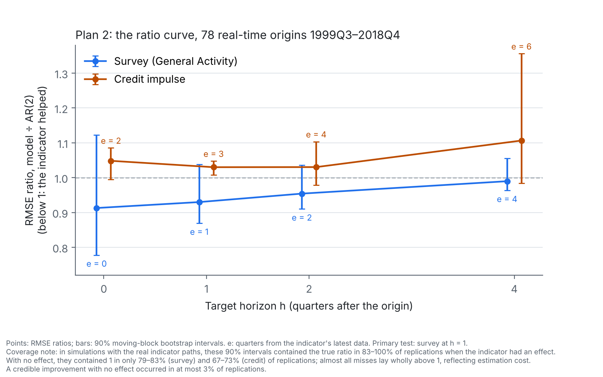
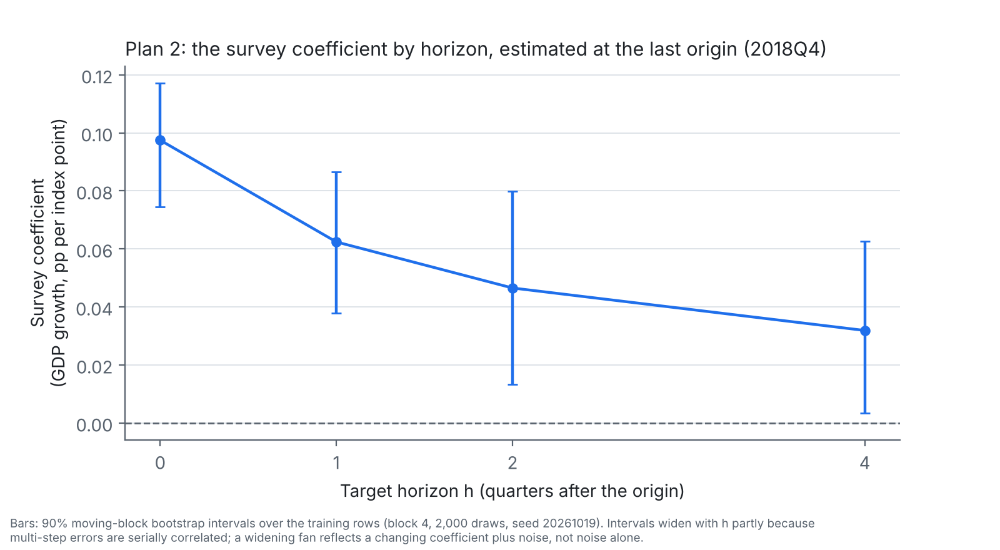

# Plan 2 results: the horizon sweep

Official run: attempt 1, 29 October 2026, 17:28:07–17:28:19 UTC, on the author's machine. All six gates passed, including both parts of gate 1, so this is the run (`plan2/PLAN.md`, Section 8). Every figure below is taken from the run's own `results_attempt1/results.json`, and was recomputed independently from `forecasts.csv` with the locked bootstrap; the two agree to three decimals. The plan was frozen at tag `plan2` (17:21:20 UTC the same day) and locked in `plan2/PLAN2_LOCK.json`. One declared wording deviation (below).

Every sentence below is a pre-written sentence from Section 7 of the plan, with its caveat. Ratios are RMSE ratios, model ÷ AR(2), over the 78 origins 1999Q3–2018Q4; below 1 means the model forecast better. Intervals are 90% moving-block bootstrap intervals (block 4, 2,000 draws, seed 20261019).

**Headline framing.** These results test whether these particular real-time survey measures, and the credit impulse, improve a direct AR(2) at the chosen horizons, with the stated power limits. They are not a general verdict on survey forecasting, nor an account of why simple models forecast well.

## Primary (Q1): the survey at h = 1

At h = 1 (1 quarter from the indicator's latest data), the survey did not improve the AR(2) credibly (ratio 0.930; 90% interval 0.869–1.038).

*Coverage caveat (Section 13): with no effect, the 90% interval contains 1 in 79–83% of replications; the median no-effect ratio is 1.003, so a credible loss can reflect estimation cost, not harm. Reliable detection needs a true ratio of about 0.85.*

## The ratio curve (Q2 and Q3)

| Horizon h | 0 | 1 | 2 | 4 |
| --- | --- | --- | --- | --- |
| Survey (General Activity) | 0.913 (0.778–1.123) | 0.930 (0.869–1.038) | 0.954 (0.910–1.036) | 0.990 (0.963–1.056) |
| Quarters from the survey's latest data | 0 | 1 | 2 | 4 |
| Credit impulse | 1.048 (0.994–1.085) | **1.030 (1.008–1.048)** | 1.030 (0.978–1.103) | 1.106 (0.984–1.356) |
| Quarters from credit's latest data | 2 | 3 | 4 | 6 |

Bold marks an interval that excludes 1. The credit cell at h = 4 reproduces the locked study's forecasts exactly at all 78 origins (gate 1).

**Survey, cell by cell.**

At h = 0 (0 quarters from the indicator's latest data), the survey did not improve the AR(2) credibly (ratio 0.913; 90% interval 0.778–1.123). *Coverage caveat (Section 13): with no effect, the 90% interval contains 1 in 79–83% of replications; the median no-effect ratio is 1.003, so a credible loss can reflect estimation cost, not harm. Reliable detection needs a true ratio of about 0.86.*

At h = 2 (2 quarters from the indicator's latest data), the survey did not improve the AR(2) credibly (ratio 0.954; 90% interval 0.910–1.036). *Coverage caveat (Section 13): with no effect, the 90% interval contains 1 in 79–83% of replications; the median no-effect ratio is 1.003, so a credible loss can reflect estimation cost, not harm. Reliable detection needs a true ratio of about 0.84.*

At h = 4 (4 quarters from the indicator's latest data), the survey did not improve the AR(2) credibly (ratio 0.990; 90% interval 0.963–1.056). *Coverage caveat (Section 13): with no effect, the 90% interval contains 1 in 79–83% of replications; the median no-effect ratio is 1.003, so a credible loss can reflect estimation cost, not harm. Reliable detection needs a true ratio of about 0.83.*

**Q2, the directional prediction.** The point ratios rise monotonically (0.913 ≤ 0.930 ≤ 0.954 ≤ 0.990), so condition (a) holds; the interval for R₄ − R₁ includes zero, so condition (b) does not.

The survey's ratios rose monotonically with the horizon, consistent with a fading relative advantage, but the rise from h = 1 (1 quarter from its latest data) to h = 4 (4 quarters) was not established (difference 0.060; 90% interval −0.029 to 0.141). *Power and coverage were not simulated for this comparison (Section 6); the interval is an estimate only.*

**Q3, credit at shorter horizons.**

At h = 0 (2 quarters from the indicator's latest data), the credit impulse did not improve the AR(2) credibly (ratio 1.048; 90% interval 0.994–1.085). *Coverage caveat (Section 13): with no effect, the 90% interval contains 1 in 67–73% of replications; the median no-effect ratio is 1.018–1.024, so a credible loss can reflect estimation cost, not harm. Reliable detection needs a true ratio of about 0.81.*

At h = 1 (3 quarters from the indicator's latest data), the credit impulse forecast credibly worse than the AR(2) (ratio 1.030; 90% interval 1.008–1.048). The coverage caveat that follows gives the estimation-cost reading. *Coverage caveat (Section 13): with no effect, the 90% interval contains 1 in 67–73% of replications; the median no-effect ratio is 1.018–1.024, so a credible loss can reflect estimation cost, not harm. This cell cannot reliably detect even a 20% gain.*

At h = 2 (4 quarters from the indicator's latest data), the credit impulse did not improve the AR(2) credibly (ratio 1.030; 90% interval 0.978–1.103). *Coverage caveat (Section 13): with no effect, the 90% interval contains 1 in 67–73% of replications; the median no-effect ratio is 1.018–1.024, so a credible loss can reflect estimation cost, not harm. This cell cannot reliably detect even a 20% gain.*

## Secondary comparisons (Q4–Q8)

Only Q1 is confirmatory. These cells are descriptive, with no adjustment for multiple comparisons (Section 6), and none was simulated for power.

| Comparison | Horizon | Quarters from latest data | Ratio (90% interval) | Rows |
| --- | --- | --- | --- | --- |
| Q4: staleness-matched survey (first month of o − 2) | 1 | 3 | **0.981 (0.962–0.998)** | 78 |
| Q5: third month of o − 1 | 1 | 2 | 0.993 (0.930–1.097) | 78 |
| Q6: New Orders | 0 | 0 | 0.859 (0.741–1.072) | 78 |
| Q6: New Orders | 1 | 1 | 0.968 (0.876–1.115) | 78 |
| Q6: New Orders | 2 | 2 | 0.949 (0.918–1.003) | 78 |
| Q6: New Orders | 4 | 4 | 0.976 (0.964–1.004) | 78 |
| Q7: survey ÷ credit, common sample | 1 | 1 and 3 | 0.902 (0.838–1.013) | 78 |
| Q8: Q1 without 2008–09 targets | 1 | 1 | 1.023 (0.952–1.109) | 70 |
| Q8: Q1 without 2001 targets | 1 | 1 | 0.941 (0.876–1.065) | 74 |

At h = 1 (3 quarters from the indicator's latest data), the staleness-matched survey improved the AR(2) credibly (ratio 0.981; 90% interval 0.962–0.998). *Power and coverage were not simulated for this comparison (Section 6); the interval is an estimate only.*

At h = 1 (2 quarters from the indicator's latest data), the third-month survey reading did not improve the AR(2) credibly (ratio 0.993; 90% interval 0.930–1.097). *Power and coverage were not simulated for this comparison (Section 6); the interval is an estimate only.*

At h = 0 (0 quarters from the indicator's latest data), New Orders did not improve the AR(2) credibly (ratio 0.859; 90% interval 0.741–1.072). *Power and coverage were not simulated for this comparison (Section 6); the interval is an estimate only.*

At h = 1 (1 quarter from the indicator's latest data), New Orders did not improve the AR(2) credibly (ratio 0.968; 90% interval 0.876–1.115). *Power and coverage were not simulated for this comparison (Section 6); the interval is an estimate only.*

At h = 2 (2 quarters from the indicator's latest data), New Orders did not improve the AR(2) credibly (ratio 0.949; 90% interval 0.918–1.003). *Power and coverage were not simulated for this comparison (Section 6); the interval is an estimate only.*

At h = 4 (4 quarters from the indicator's latest data), New Orders did not improve the AR(2) credibly (ratio 0.976; 90% interval 0.964–1.004). *Power and coverage were not simulated for this comparison (Section 6); the interval is an estimate only.*

On the common sample, at h = 1 (1 quarter from the survey's latest data and 3 from credit's), the survey forecast about as well as the credit model (ratio 0.902; 90% interval 0.838–1.013). The survey's data were about five months fresher; this compares the survey indicator tested here with credit, each as available at the origin, not the two indicators' content. *Power and coverage were not simulated for this comparison (Section 6); the interval is an estimate only.*

Without the 2008–09 targets: at h = 1 (1 quarter from the indicator's latest data), the survey did not improve the AR(2) credibly (ratio 1.023; 90% interval 0.952–1.109). *Power and coverage were not simulated for this comparison (Section 6); the interval is an estimate only.*

Without the 2001 targets: at h = 1 (1 quarter from the indicator's latest data), the survey did not improve the AR(2) credibly (ratio 0.941; 90% interval 0.876–1.065). *Power and coverage were not simulated for this comparison (Section 6); the interval is an estimate only.*

## Exploratory

Not preregistered as tests; reported as exploratory, using the same sentence forms.

| Comparison | Horizon | Ratio (90% interval) |
| --- | --- | --- |
| Credit + survey vs credit, common sample | 1 | 0.915 (0.854–1.029) |
| Survey, training from 1985Q1 | 0 | 0.915 (0.851–1.009) |
| Survey, training from 1985Q1 | 1 | **0.952 (0.921–0.984)** |
| Survey, training from 1985Q1 | 2 | 0.954 (0.899–1.037) |
| Survey, training from 1985Q1 | 4 | 0.989 (0.969–1.034) |

Exploratory: at h = 1 (1 quarter from the indicator's latest data), with training rows from 1985Q1 and the same 78 origins, the survey improved the AR(2) credibly (ratio 0.952; 90% interval 0.921–0.984). Its value at the origin may reflect freshness as well as content (Section 3). *Power and coverage were not simulated for this comparison (Section 6); the interval is an estimate only.*

## Figures

*Figure 1. The ratio curve. In simulations using the real indicator paths, these 90% intervals contained the true ratio in 83–100% of replications when the indicator had an effect. With no effect, they contained 1 in only 79–83% of replications for the survey and 67–73% for credit; almost all the misses lay wholly above 1, reflecting estimation cost. A credible improvement with no effect occurred in at most 3% of replications.*

*Figure 2. The survey coefficient by horizon, estimated at the last origin (2018Q4) on its training rows, with a moving-block bootstrap interval over those rows. Intervals widen with h partly because multi-step errors are serially correlated; a widening fan reflects a changing coefficient plus noise, not noise alone.*

| Horizon h | 0 | 1 | 2 | 4 |
| --- | --- | --- | --- | --- |
| Coefficient (90% interval) | 0.097 (0.075–0.117) | 0.062 (0.038–0.086) | 0.047 (0.013–0.080) | 0.032 (0.003–0.063) |
| Training rows | 201 | 200 | 199 | 197 |

## Test statistics, reported for completeness

Diebold–Mariano with the Harvey–Leybourne–Newbold correction, and its one-sided block-bootstrap p-value for an improvement (Section 6). Reported, not interpreted.

| Cell | HLN t | p (bootstrap) | Error correlation |
| --- | --- | --- | --- |
| Survey, h = 0 | 0.82 | 0.235 | 0.80 |
| Survey, h = 1 | 1.41 | 0.176 | 0.93 |
| Survey, h = 2 | 1.14 | 0.183 | 0.96 |
| Survey, h = 4 | 0.37 | 0.315 | 0.97 |
| Credit, h = 0 | -1.43 | 0.867 | 0.99 |
| Credit, h = 1 | -2.23 | 0.946 | 0.99 |
| Credit, h = 2 | -1.01 | 0.811 | 0.97 |
| Credit, h = 4 | -1.17 | 0.852 | 0.89 |

## Gate record

| Gate | Result |
| --- | --- |
| 1. Locked h = 4 forecasts reproduced exactly (part 1); `fit()` equals the locked function (part 2) | Pass, both parts |
| 2. Release rule | Pass |
| 3. Seasonal adjustment recomputed independently | Pass |
| 4. Forecasts finite and responsive | Pass |
| 5. Placebo not credibly below 1 | Pass: ratio 0.998 (90% interval 0.990–1.012) at h = 1 |
| 6. Survey files match the locked hashes | Pass |

The placebo is a pipeline check, not a result.

## Declared deviation

**Wording, Q4 (Section 10: wording other than Section 7's).** Section 7 adds "Its value at the origin may reflect freshness as well as content" to every credible survey improvement. Q4's covariate is the first-month reading of quarter o − 2, not the reading at the origin, so the clause is factually inapplicable and is omitted from the Q4 sentence. The clause was written for covariates read at the origin; it is kept for the exploratory post-1985 cell, whose covariate is the first-month reading of quarter o. Results had been seen when this was decided (29 October 2026, after the run). No number changes.

## Reading notes

These notes are not preregistered sentences. They state facts about the numbers above that a reader needs to read the sentences side by side; they draw no conclusion the sentences do not.

- **"Credibly improved" and "did not credibly improve" differ in precision, not size.** Q4's point gain (ratio 0.981, about 2%) is smaller than Q1's (0.930, about 7%). Q4's interval is narrow because its forecast errors track the AR(2)'s almost exactly (error correlation 0.99, against 0.93 for Q1), so a small difference is measured precisely. Q1's larger gain is measured less precisely.
- **Q4 is one of many secondary cells.** Its "credible" label describes where its interval lies under Section 6's rule; it is not a confirmatory finding, and the multiple-comparison context below is why it should not be read as a discovery. The run reports eighteen secondary and exploratory intervals (Q2–Q8 and the exploratory cells) with no adjustment for multiple comparisons. With no effect, an interval wholly below 1 occurred in up to 3% of simulated replications per cell, so one or two such intervals across eighteen cells would not be unusual. Q4 was not simulated for power, is matched in quarter not month, and differs from Q1 in calendar month, seasonal mean and training start (1969Q1). It does not separate content from freshness.
- **The coefficient curve has no decision rule.** Its intervals exclude zero at every horizon; the plan set no rule for the coefficients, so this is descriptive. A coefficient that is reliably non-zero over about 200 training rows and a forecasting gain that is not credible over 78 real-time origins answer different questions and do not conflict.

## Use of AI

The author is responsible for all design decisions, modelling runs, interpretation, and final content. AI tools (including Claude, ChatGPT, Microsoft Copilot, DeepSeek, Kimi, and Z.ai) were used for drafting text, writing and testing scripts, checking outputs, and performing sanity-checks on reasoning and code. All modelling was executed by the author, who retains full responsibility for the analysis and results.
