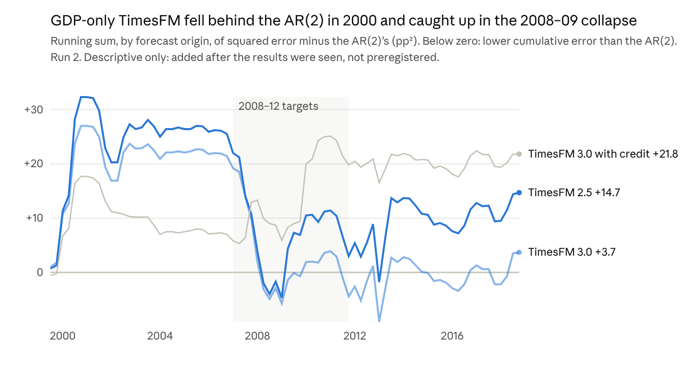

# A foundation-model extension: TimesFM and real-time US GDP forecasts, 1999–2019

26 October 2026

**Andy Moran**, Heaviside Analytics. A preregistered extension to the working paper "Did the Credit Impulse Help Forecasters in Real Time?" (v2.2, DOI 10.5281/zenodo.23560860). This note is archived at DOI 10.5281/zenodo.23675487.

## Summary

Given only real-time data, neither TimesFM 2.5 nor TimesFM 3.0 forecast US GDP growth four quarters ahead credibly better than a direct AR(2), over 78 origins from 1999Q3 to 2018Q4 (ratios 1.015 and 1.004; 90% intervals 0.953–1.120 and 0.952–1.081). Adding the real-time credit impulse, in the forms tested (four lags through a linear first stage for TimesFM 2.5, one native covariate for TimesFM 3.0), did not credibly improve either model, and the revised-credit premium was small for both. These intervals are known to undercover on this credit path; see Section 5.1 of the paper. Section 2 sets out what the comparisons can and cannot detect.

If, as the plan assumes, seeing data from after the forecast dates can only help, this is a generous test, and it still found no credible gain; Section 5 explains why that assumption may not hold. The credit comparisons are underpowered: the locked study's simulations imply that only RMSE reductions of roughly 40% would be reliably detected, so F3–F5 show no credible improvement detected, not no effect. The locked study found the same for a linear credit model; this extension cannot change that study's headline.

The extension was preregistered: the plan was tagged `timesfm-plan` on 26 October 2026, before any TimesFM forecast of real data. Section 6 declares the deviations. The main one: run 1, the first completed run, had a defect in the code that read TimesFM 2.5's output. It was found from the outputs, fixed in public and run again. Run 2 is reported, and every run 1 result the defect affected is given beside it.

## 1. Question and design

The working paper (v2.2, DOI [10.5281/zenodo.23560860](https://doi.org/10.5281/zenodo.23560860)) found that adding the real-time credit impulse to a direct AR(2) did not improve four-quarter-ahead forecasts of US GDP growth over 1999–2019. Its largest losses came in 2010–11, when the credit model read the collapse in borrowing as a sign of a sharp rebound. This note asks three narrower questions:

1. Does a pretrained foundation model, used as published and given only real-time data, forecast GDP growth better than the AR(2)?
2. Does adding the real-time credit impulse help the foundation model, where it did not help the linear model?
3. Do revised credit data change the answer to question 2?

**Preregistration.** The plan (`timesfm/PLAN.md`) and the public scripts were committed and tagged `timesfm-plan` (commit 7406c2c) on 26 October 2026 at 17:26 UTC. At that point TimesFM had been run only on synthetic series. `timesfm/PLAN_LOCK.json` records the hashes of every file, the checkpoints and the package versions. The plan, code and results are in the public repository, github.com/AndyMoran/credit-impulse-realtime-prereg.

**Models.** Both are used as published, with no fine-tuning and no setting tuned on the forecast sample.

| Model | Weights licence | Role | Credit input |
| --- | --- | --- | --- |
| TimesFM 2.5 (200M) | Apache-2.0 | Main analysis | Four lagged covariates through the XReg add-on, all published by the origin |
| TimesFM 3.0 (330M) | TimesFM Non-Commercial License v1.0 | Research-only comparison | One past-only covariate, native to the model |

**Inputs.** The data are the frozen files of the locked study. At each of the 78 origins, the models see GDP growth from the origin's real-time vintage, 1965Q1 to o − 1, and the credit impulse from the latest Z.1 release before the origin, ending at o − 2. The target is quarter o + 4, scored against the 2026Q3 vintage. Revised credit (question 3) is the September 2026 release, cut at the same edge. GDP enters as annualised quarterly growth in percent, discretely compounded, as in the locked study. TimesFM 3.0 receives one covariate: the credit impulse, shifted so that each position holds the value published by then (plan Section 3, Rule B). TimesFM 2.5's XReg linear stage is re-fitted at every origin on that origin's own context.

**Comparisons.** Each is an RMSE ratio over the 78 origins, with the locked moving-block bootstrap (block 4, 2,000 draws, 90% intervals). Below 1 means the first model forecast better. A credible improvement requires the whole interval to lie below 1. TimesFM's point forecast is its median, while the AR(2) forecasts the conditional mean; under squared error the mean is the better target, so a skewed TimesFM forecast distribution is mildly penalised.

| Label | Comparison | Question |
| --- | --- | --- |
| F1 | TimesFM 2.5, GDP only, vs AR(2) | 1 |
| F2 | TimesFM 3.0, GDP only, vs AR(2) | 1 |
| F3 | TimesFM 3.0 with real-time credit vs without | 2 |
| F4 | TimesFM 2.5 with real-time credit (XReg) vs without | 2 |
| F5 | F3 and F4 with revised credit: the premium | 3 |

F4 is not a test of non-linear credit use. XReg fits a linear regression on the credit lags first and TimesFM forecasts the residuals, so any credit effect in F4 passes through a linear fit. Only F3 is even positioned to bear on non-linear credit use, and it is underpowered and may be affected by credit data seen in training.

## 2. Results

No comparison shows a credible improvement, and both revised-credit premiums are small. The figures are from run 2 (Section 6).

| Label | Comparison | RMSE ratio | 90% interval | Credible improvement | DM-HLN p-value |
| --- | --- | --- | --- | --- | --- |
| F1 | TimesFM 2.5 vs AR(2) | 1.015 | 0.953–1.120 | No | 0.70 |
| F2 | TimesFM 3.0 vs AR(2) | 1.004 | 0.952–1.081 | No | 0.63 |
| F3 | TimesFM 3.0 with credit vs without | 1.018 | 0.966–1.053 | No | 0.70 |
| F4 | TimesFM 2.5 with credit (XReg) vs without | 1.047 | 0.996–1.161 | No | 0.86 |

| Label | Premium (real-time ratio minus revised ratio) | 90% interval | Size |
| --- | --- | --- | --- |
| F5, TimesFM 2.5 | +0.009 | −0.029 to +0.031 | Small |
| F5, TimesFM 3.0 | +0.002 | −0.016 to +0.013 | Small |

DM-HLN is the Diebold–Mariano statistic with the Harvey–Leybourne–Newbold small-sample correction; its p-values are one-sided block-bootstrap p-values for an improvement, reported for completeness and not interpreted. The undercoverage note was established for the locked study's credit comparisons; for F1 and F2 it is a caution, not a measured property. The "generous test" clause is the plan's; for F3 and F4 it may run the other way (Section 5). The pre-written sentences follow, one per comparison.

**F1.** Given only real-time data, TimesFM 2.5 did not forecast GDP growth credibly better than the AR(2) (ratio 1.015; 90% interval 0.953–1.120). Because the model may have seen data from after the forecast dates, this is, if anything, a generous test, and it still found no credible gain. These intervals are known to undercover on this credit path; see Section 5.1 of the paper.

**F2.** Given only real-time data, TimesFM 3.0 did not forecast GDP growth credibly better than the AR(2) (ratio 1.004; 90% interval 0.952–1.081). Because the model may have seen data from after the forecast dates, this is, if anything, a generous test, and it still found no credible gain. These intervals are known to undercover on this credit path; see Section 5.1 of the paper.

**F3.** Given only real-time data, TimesFM 3.0 did not forecast credibly better with credit than without credit (ratio 1.018; 90% interval 0.966–1.053). Because the model may have seen data from after the forecast dates, this is, if anything, a generous test, and it still found no credible gain. These intervals are known to undercover on this credit path; see Section 5.1 of the paper.

**F4.** Given only real-time data, TimesFM 2.5 did not forecast credibly better with credit than without credit (ratio 1.047; 90% interval 0.996–1.161). Because the model may have seen data from after the forecast dates, this is, if anything, a generous test, and it still found no credible gain. F4 runs credit through a linear fit, so it does not show whether the model uses credit non-linearly. These intervals are known to undercover on this credit path; see Section 5.1 of the paper.

**F5.** The revised-credit premium is small for both models: +0.009 for TimesFM 2.5 and +0.002 for TimesFM 3.0, both with intervals that include zero. A positive premium means revised credit forecast better. These intervals are known to undercover on this credit path; see Section 5.1 of the paper.

**Power.** No new power analysis was run. The plan carries over the locked study's finding that, on this credit path, only RMSE reductions of roughly 40% or more (a ratio near 0.6) could be detected with 80% power in the credit comparisons. That figure comes from simulations of the linear credit model, so it is a caution for F3–F5, not a property estimated for TimesFM. The paired forecasts are highly correlated, so the ratio intervals here are narrow; but these intervals are known to undercover (paper Section 5.1), so even these widths overstate precision. The power of F1 and F2 was not estimated.

## 3. The 2010–12 forecasts

Over the eight origins 2010Q1–2011Q4, fixed by the plan, the locked credit model forecast 4.3% to 7.5% growth; the outcomes ranged from −0.9% to 4.6%. Across the TimesFM columns shown, forecasts ranged from 2.1% to 4.0%; TimesFM 2.5 with credit, which the plan does not list for this table, reached 5.3% at the 2010Q4 origin (forecasts.csv). Figures are annualised quarterly real GDP growth, in percent; outcomes are from the 2026Q3 vintage.

| Origin | Target | Outcome | AR(2) | Locked credit model | TimesFM 2.5 | TimesFM 3.0 | TimesFM 3.0 with credit |
| --- | --- | --- | --- | --- | --- | --- | --- |
| 2010Q1 | 2011Q1 | −0.9 | 2.8 | 5.4 | 3.3 | 3.2 | 4.0 |
| 2010Q2 | 2011Q2 | 2.7 | 2.9 | 6.7 | 3.1 | 3.1 | 3.7 |
| 2010Q3 | 2011Q3 | −0.1 | 3.0 | 6.8 | 2.8 | 2.9 | 3.5 |
| 2010Q4 | 2011Q4 | 4.6 | 3.0 | 7.5 | 2.5 | 2.5 | 2.8 |
| 2011Q1 | 2012Q1 | 3.4 | 2.9 | 6.5 | 2.7 | 2.7 | 2.9 |
| 2011Q2 | 2012Q2 | 1.8 | 3.0 | 5.8 | 2.5 | 2.5 | 2.6 |
| 2011Q3 | 2012Q3 | 0.6 | 3.1 | 5.5 | 2.1 | 2.1 | 2.4 |
| 2011Q4 | 2012Q4 | 0.5 | 3.0 | 4.3 | 2.1 | 2.1 | 2.6 |

The TimesFM forecasts are medians. The full set, including TimesFM 2.5 with credit and both revised-credit versions, is in `forecasts.csv`.

## 4. Descriptive results

### The lower tail (specified in the plan; no formal comparison)

Each model's 10th percentile was undershot about 10% of the time over all origins, and 25–35% of the time for 2008–12 targets.

| Forecast | 10% quantile loss, all 78 | 10% quantile loss, 2008–12 targets | Outcomes below 10th percentile, all 78 | Below, 2008–12 targets |
| --- | --- | --- | --- | --- |
| AR(2) | 0.498 | 0.883 | 10.3% | 25% |
| TimesFM 2.5 | 0.546 | 0.976 | 9.0% | 25% |
| TimesFM 2.5 with credit | 0.566 | 1.013 | 11.5% | 35% |
| TimesFM 3.0 | 0.552 | 1.014 | 10.3% | 30% |
| TimesFM 3.0 with credit | 0.555 | 1.111 | 11.5% | 30% |

The AR(2)'s 10th percentile is its forecast plus the empirical 10th percentile of its training residuals at each origin. There are 20 targets in 2008–12, so each one there is 5 percentage points. Quantile losses are in percentage points of annualised growth. These figures are descriptive only; no comparison of them was preregistered.

### Cumulative error paths (not preregistered)

This chart was added after the results were seen. It is descriptive, tests nothing and changes no verdict.

*Computed from run 2 forecasts.csv · 78 origins, 1999Q3–2018Q4 · not preregistered*

Each line adds up, origin by origin, a model's squared error minus the AR(2)'s, so it ends at that model's total excess over the AR(2), whose own total is 485.7. Both GDP-only models fell behind at the 2000 origins, when they forecast growth near 4% into the 2001 slowdown. They made up ground on the 2008–12 targets (−22.5 for TimesFM 2.5 and −25.8 for TimesFM 3.0), while TimesFM 3.0 with credit lost ground there (+12.8). No comparison separates credibly in either direction: all four point ratios are slightly above 1, and the intervals allow improvements of up to about 5% for F1 and F2, and less for F3 and F4. Holding a direct AR(2) to that at a four-quarter horizon on real-time GDP is itself a strong showing for the benchmark.

## 5. Leakage checks

Neither L1 nor L2 raised a flag for either model. TimesFM 2.5's L0 rating of High is a leakage concern under the plan, but no comparison shows a gain, so the wording of every result is the same either way. The plan's "generous test" sentence assumes that training on later data can only help. It could also hurt: the training data hold revised series, while the models were given real-time vintages. For F3 and F4 it could make the test conservative rather than generous: TimesFM 2.5's training data include US credit series, so its without-credit arm may already carry some credit information.

**L0, training data (before freezing).** TimesFM 2.5 is rated **High**: its training data include GiftEvalPretrain, which in turn includes `fred_md`, which holds the US unemployment rate and US credit series through the 2008–12 episode. TimesFM 3.0 is rated **Uncertain**: its card says datasets overlapping fev-bench were excluded, and fev-bench includes later vintages of FRED-MD and FRED-QD, but the exact exclusions, the M1 and M3 series kept, and the synthetic data cannot be checked.

**L1, perturbation.** Revision-sized noise (SD 1.405 pp, 20 draws, the same draws for every model) was added to the GDP history. The degradation ratio is the mean perturbed RMSE divided by the unperturbed RMSE. A flag needed the TimesFM ratio to exceed the AR(2)'s by more than 0.10 over all origins, or 0.20 over 2010Q1–2011Q4.

| Model | Ratio, all 78 | Ratio, 2010–11 | Excess over AR(2), all | Excess, 2010–11 | Flag |
| --- | --- | --- | --- | --- | --- |
| AR(2) | 0.995 | 0.984 | — | — | — |
| TimesFM 2.5 | 0.988 | 0.988 | −0.008 | +0.004 | No |
| TimesFM 3.0 | 0.994 | 1.013 | −0.002 | +0.029 | No |

The AR(2) values were computed by the pipeline test before freezing and are disclosed in the plan; the TimesFM values were not known before the run. The 20 per-draw ratios are in the appendix and in `results.json`.

**L2, shape-matched placebo.** Fifty synthetic GDP histories copy the 2008–12 path, rescaled by 0.8–1.2 with revision-sized noise, after AR(2)-simulated earlier decades. Each model forecasts the eight origins 2010Q1–2011Q4, and its RMSE is divided by the AR(2)'s on the same series. A flag needed the real-series ratio to fall below the placebos' 10th percentile. The AR(2) is re-estimated on each synthetic series, and the real series is the 2026Q3 vintage. L2 therefore runs on revised data throughout, to match the placebos, which have no vintages. Its real-series ratios (0.882 and 0.903) are not the real-time ratios over the same eight origins in Section 3 (about 0.95 for both models), and L2, unlike L1, tests memory in revised-data space, the space the L0 concern is about.

| Model | Real-series ratio | Placebo 10th percentile | Placebo median | Real series' percentile | Flag |
| --- | --- | --- | --- | --- | --- |
| TimesFM 2.5 | 0.882 | 0.792 | 0.900 | 44th | No |
| TimesFM 3.0 | 0.903 | 0.801 | 0.915 | 34th | No |

On the real 2010–11 path, both models did about as well relative to the AR(2) as on look-alike paths. That is consistent with behaviour that does not depend on the exact real sequence.

The placebos keep the episode's shape, so L2 tests memory of the exact values rather than of the shape. Their median ratio is below 1, so the flag is conservative by construction. Neither check was tried on a case with known memory (a positive control), so their sensitivity is unknown. L1 perturbs the real-time vintages the models received, which differ most from the revised training data in the crisis years. None of these checks proves or rules out leakage. They make memory of the specific US series more or less plausible, and that is all they are reported as doing.

## 6. Deviations from the plan

The plan allowed one run. There were three attempts: attempt 1 failed before any model ran; attempt 2 (run 1) completed with a defect; attempt 3 (run 2) is the one reported in Sections 2–5. The audit log, Entries 67–70, and `DEVIATIONS.md` record each step.

| Attempt | Time (UTC, 26 Oct 2026) | What happened | Results seen? |
| --- | --- | --- | --- |
| 1 | 17:49 | Stopped while loading the locked data: `openpyxl` was missing. No model had been called and no output was written. `openpyxl` 3.1.5 was installed; no other package changed. | No |
| Run 1 | 18:05 | Completed. A defect in the TimesFM 2.5 wrapper made the GDP-only TimesFM 2.5 "forecasts" backcast values, not forecasts. | Yes |
| Run 2 | 18:35 | Completed after a fix committed in public (commit d2d7acd): the wrapper takes the last five rows and checks the output length, and two self-tests were added. | Yes |

**The defect.** XReg needs the package's `return_backcast` setting on. With it on, TimesFM 2.5 returns its backcast over the context first and the forecast last; the wrapper took the first five rows instead of the last five. The XReg route and TimesFM 3.0 strip or never return the backcast, so they were unaffected. It was found from the outputs: in run 1, the GDP-only TimesFM 2.5 10th percentile equalled its median at all 78 origins, and its forecasts barely moved through 2008–09. The script tests had not caught it, because backcast values pass every check they made. Two checks were added: the forecast must respond to a shift in the last observations, and the 10th percentile must lie below the median.

**Run 1 results that the defect affected.**

| Result | Run 1 (defective) | Run 2 (reported) |
| --- | --- | --- |
| F1, TimesFM 2.5 vs AR(2) | 0.903 (0.852–0.990) | 1.015 (0.953–1.120) |
| F1, DM-HLN p-value | 0.061 | 0.697 |
| F4, TimesFM 2.5 with credit vs without | 1.177 (1.071–1.352) | 1.047 (0.996–1.161) |
| F4, DM-HLN p-value | 0.990 | 0.858 |
| F5, TimesFM 2.5 premium | +0.010 (−0.032 to +0.035) | +0.009 (−0.029 to +0.031) |
| TimesFM 2.5 10% quantile loss, all / 2008–12 | 0.807 / 1.777 | 0.546 / 0.976 |
| TimesFM 2.5 outcomes below 10th percentile, all / 2008–12 | 44.9% / 65% | 9.0% / 25% |
| L1, TimesFM 2.5 ratio, all / 2010–11 | 1.000 / 0.997 | 0.988 / 0.988 |
| L1, TimesFM 2.5 excess, all / 2010–11 | +0.005 / +0.013 | −0.008 / +0.004 |
| L2, TimesFM 2.5 real-series ratio (percentile) | 0.818 (38th) | 0.882 (44th) |
| L2, placebo 10th percentile / median | 0.751 / 0.850 | 0.792 / 0.900 |

Run 1's F1 was the only credible improvement in either run, and the fix removed it. The fix also removed a credible deterioration: in run 1, F4's whole interval lay above 1 (1.071–1.352), so credit made TimesFM 2.5 credibly worse; in run 2 it does not (0.996–1.161). Both changes moved toward the null, the direction of the locked study's headline. No comparison moved into or out of "credible improvement" other than F1, and no leakage flag changed. The form of the fix was set by the package code, not by the results. The two behavioural checks added after run 1 would have caught the defect on synthetic data; they belonged in the tests run before the freeze. Everything not tied to the GDP-only TimesFM 2.5 forecasts is bit-for-bit identical in the two runs: outcomes, the AR(2), all TimesFM 3.0 forecasts and all TimesFM 2.5 forecasts with credit. F4 and the TimesFM 2.5 premium moved only because their without-credit comparator changed.

**Wording.** Section 7 of the plan gives one sentence with a slot, "\[GDP growth / better with credit\]". For F3 and F4 the slot is filled with credit, and the sentence's grammar is corrected ("did not forecast credibly better with credit than without credit") without changing its content. The summary and the explanatory text around the tables are not pre-written sentences. They restate the pre-written results and add no comparison or verdict, but they are declared here as a wording deviation. The cumulative-error chart in Section 4 was added after the results were seen, at a reviewer's suggestion, and is labelled as not preregistered.

## 7. Run record, licence and AI use

**Run record.** Run 2 ran on 26 October 2026 at 18:35 UTC, on Python 3.11.17 under WSL2. Both models ran on the CPU, as the plan states. The installed torch is a CUDA build (2.14.1+cu130), but no GPU was available to it (torch.cuda.is\_available() returned False), so TimesFM 2.5 fell back to the CPU.

| Item | Value |
| --- | --- |
| Plan tag | `timesfm-plan`, commit 7406c2c, 17:26:15 UTC |
| Fix commit | d2d7acd |
| Scripts at run 2 | `tfm_models.py` 32d74a24… (fixed); `tfm_selftest.py` 2c5c032a… (fixed); `tfm_data.py` ea06196e…, `run_timesfm.py` 23d70214… (as frozen) |
| Inputs | Frozen data files of `v1.0-lock` and `v2.0-results`, hashed in `MANIFEST.txt` and `MANIFEST_v2.txt`; locked `phase2.py` da697030… |
| TimesFM 2.5 checkpoint | `google/timesfm-2.5-200m-pytorch` @ 1d952420…, weights SHA-256 2f776efe… |
| TimesFM 3.0 checkpoint | `google/timesfm-3.0-pytorch` @ 43046b85…, weights SHA-256 a7592b0a… |
| Packages | `timesfm` 3.0.2, `torch` 2.14.1 (+cu130 build), `jax` and `jaxlib` 0.10.2, `scikit-learn` 1.9.1, `numpy` 2.4.6, `huggingface_hub` 2.3.0, `safetensors` 0.8.0, `openpyxl` 3.1.5 (installed after attempt 1) |
| Run 2 outputs | `results.json` 68c4ca49…, `forecasts.csv` c6b85a44…, `table_2010_12.csv` b9b6e873…, `run_log.txt` 44c89466… |
| Run 1 outputs (defective, kept) | `results.json` 9960e6f8…, `forecasts.csv` c43f37dd… |

Full hashes are in `PLAN_LOCK.json`, the audit log and the results folders in the [repository](https://github.com/AndyMoran/credit-impulse-realtime-prereg).

**Licence.** TimesFM 2.5's weights are Apache-2.0, and its code here is MIT-licensed. TimesFM 3.0's weights are under the TimesFM Non-Commercial License v1.0. The licence states that outputs are not Derivatives, so its forecasts are published here, but the script that calls the model is not, because the licence forbids distributing works that use the model; its settings are described in the plan and its hash is recorded. No TimesFM 3.0 output is used in commercial work.

**Use of AI.** The author is responsible for all design decisions, modelling runs, interpretation, and final content. AI tools (including Claude, Microsoft Copilot, DeepSeek, and Z.ai) were used for drafting text, writing and testing scripts, checking outputs, and performing sanity‑checks on reasoning and code. The defect described in Section 6 originated in code produced with Claude’s assistance and was identified during checking of run 1. All modelling was executed by the author, who retains full responsibility for the analysis and results.

## Appendix: L1 per-draw degradation ratios

Each entry is one draw's perturbed RMSE divided by the unperturbed RMSE, for run 2. The same 20 perturbations (seeds 20261019 + k) were applied to every model.

| Draw | AR(2), all | TimesFM 2.5, all | TimesFM 3.0, all | AR(2), 2010–11 | TimesFM 2.5, 2010–11 | TimesFM 3.0, 2010–11 |
| --- | --- | --- | --- | --- | --- | --- |
| 1 | 1.040 | 1.034 | 1.039 | 1.069 | 0.946 | 1.018 |
| 2 | 1.012 | 0.982 | 0.987 | 0.993 | 0.893 | 0.923 |
| 3 | 0.975 | 0.990 | 1.002 | 1.006 | 0.969 | 1.044 |
| 4 | 1.007 | 0.926 | 0.954 | 0.963 | 0.869 | 0.913 |
| 5 | 0.997 | 0.991 | 0.995 | 0.983 | 1.019 | 1.057 |
| 6 | 0.984 | 0.942 | 0.945 | 0.969 | 1.005 | 1.012 |
| 7 | 0.963 | 0.985 | 0.986 | 0.920 | 0.944 | 0.979 |
| 8 | 0.987 | 0.982 | 1.000 | 0.969 | 0.964 | 0.962 |
| 9 | 1.025 | 1.040 | 1.036 | 0.998 | 1.171 | 1.205 |
| 10 | 1.008 | 0.994 | 0.993 | 0.976 | 1.122 | 1.120 |
| 11 | 0.986 | 1.027 | 1.037 | 0.959 | 1.134 | 1.164 |
| 12 | 0.993 | 1.013 | 1.013 | 1.002 | 1.108 | 1.113 |
| 13 | 0.958 | 0.952 | 0.961 | 0.965 | 0.913 | 0.951 |
| 14 | 1.020 | 1.013 | 1.012 | 1.045 | 1.011 | 1.077 |
| 15 | 0.987 | 1.003 | 1.007 | 0.960 | 1.050 | 1.017 |
| 16 | 0.996 | 0.961 | 0.971 | 1.003 | 0.910 | 0.912 |
| 17 | 0.971 | 0.963 | 0.958 | 0.887 | 1.009 | 1.010 |
| 18 | 0.996 | 1.016 | 1.029 | 1.003 | 0.957 | 0.966 |
| 19 | 1.013 | 0.954 | 0.964 | 1.033 | 0.907 | 0.923 |
| 20 | 0.989 | 0.986 | 0.985 | 0.984 | 0.857 | 0.894 |
